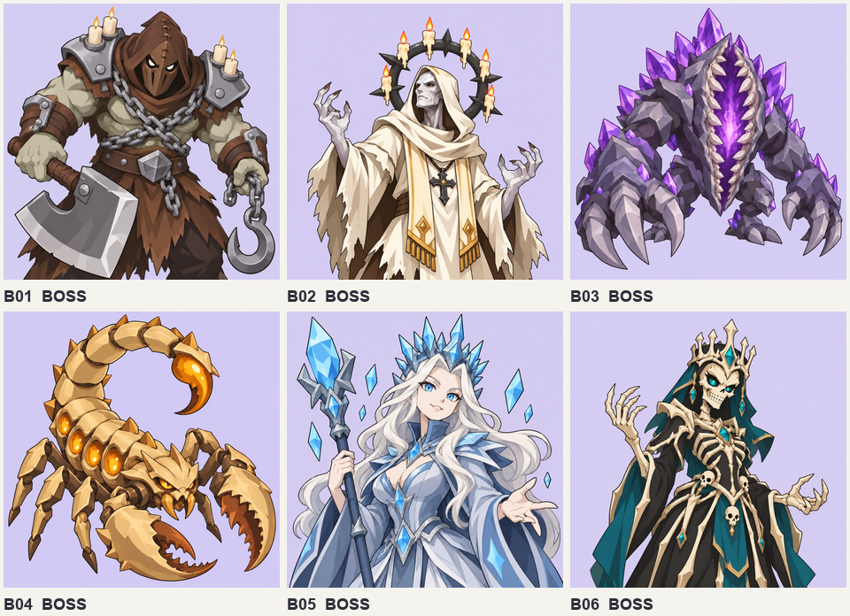
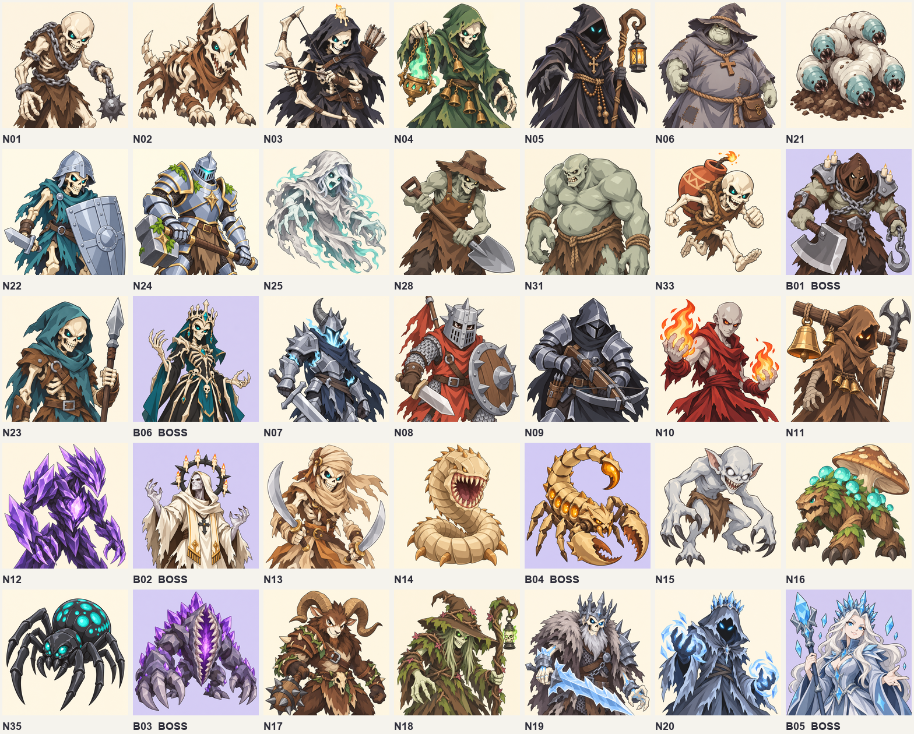
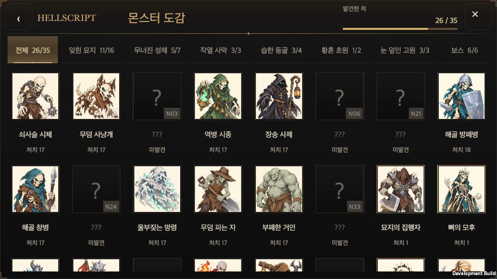

# 캐주얼 몬스터 도감 일러스트와 비율 보정

2026-10-14 · [English](README.en.md)

사용자 요청: 도감 몬스터 35종을 캐주얼 StyleD로 다시 그리고, 얼굴이 잘리는 표시 문제를 함께 수정한다. 최신 main `53d6a3e13304a781f9823134ba0f497bafb78621`에서 별도 관리형 작업 폴더로 시작했다. 다른 작업의 그림·문서·변경은 보존한다.

필수 원본은 남전사 설정 시트와 StyleD 타이틀이다. 몬스터 종류·고유 소품·실루엣은 기존 초상과 제작 명세를 따른다. 새 초상은 불투명 정사각형, 굵은 외곽선과 단순 셀 명암으로 맞춘다. 일반 29종은 아이보리, 보스 6종은 연한 라벤더 배경으로 구분한다. 얼굴·턱·뿔·귀와 식별 부위를 프레임 안에 넣고 얼굴을 크게 표시한다. 비인간형은 고유 머리·입·핵심 수정이 읽히는 구도를 사용한다.

목록과 상세의 공통 `MonsterCodexWindow.Portrait`는 원본 전체 UV를 유지하고, 비율을 보존하며 표시 영역 안에 맞춘다. 얼굴을 자르는 중앙 크롭이나 정사각형 강제 늘리기를 사용하지 않는다. 기존 PNG의 `.meta`와 GUID, 저장·처치·전투 정의는 보존한다.

내장 `image_gen`를 사용한다. 도구는 실제 모델 식별자를 반환하지 않는다. 따라서 모델을 `unknown`, 출시 승인을 `productionApproved: false`로 기록하며 `gpt-image-2` 사용을 증명하지 않는다. 기존 다크 판타지 원본은 Git 이력에서 복구할 수 있다. 프롬프트·대상·해시와 실제 치수는 제작 목록에 기록한다.

몬스터 35종의 재작화를 완료했다(내장 생성 39회, 구도·재질 교정 4회 포함). 모든 런타임 PNG는 1254×1254, 불투명 RGB이며 합계 63,061,786바이트다. 기존 33종의 .meta는 변경하지 않았고 N23·B06의 새 .meta는 Unity가 생성했다. 두 몬스터의 월드 모델 대기 상태를 유지하면서 준비된 도감 초상을 표시한다. 보스·ID 표시는 얼굴 아래에 두고 줄바꿈·겹침을 방지한다. 밝은 그림 위에서도 글자가 보이도록 공통 UI의 불투명 배경을 쓴다. 최종 관련 창 검사 17개와 UI 계약 회귀 15개를 통과했다. macOS 개발 앱에서 5개 크기·한국어/영어, 실제 처치·저장·재로드와 클릭·드래그를 검증했다. 마지막 배경색 보정은 창 검사·컴파일로 확인하고 동일한 얼굴·배율·조작 결과를 재사용한다. 변경 없는 전투·저장 영역은 최신 main의 전체 검사·설명 보정 결과를 재사용한다. 모바일 실기기·확대 글꼴은 미검증이며 공개 게임 배포는 하지 않았다.

## 제작·검증 근거

보스 배경 변경은 내장 이미지 편집 8회로 완료했다(전갈 배경 경계 교정 2회 포함, 전체 생성·편집 47회). 현재 35종 PNG 합계는 63,338,362바이트다. 29종 일반 초상과 35종 메타는 후속 변경 전과 동일하다. 보스의 얼굴·왕관·소품 구도를 직접 확인하고 정사각형 RGB·원본 복사 해시를 검증했다. 앞선 macOS 조작 검증 결과는 코드·표시 크기가 같아 재사용하며, 아래 네이티브 화면은 보스 배경 변경 전이다.

[보스 배경 편집 기록](boss-background-manifest.json) · [후속 PNG·메타 확인](validation/boss-background-assets.json)

[프롬프트와 원본 해시](generation-manifest.json) · [PNG/GUID 확인](validation/portrait-assets.json) · [창 검사](validation/focused-window-final.xml) · [표시 코드](../../../../Assets/HELLSCRIPT/Runtime/Presentation/MonsterCodexWindow.cs)

런타임 원본 PNG: [N01](../../../../Assets/HELLSCRIPT/Resources/Art/TrainingGround/Portraits/N01.png), [N02](../../../../Assets/HELLSCRIPT/Resources/Art/TrainingGround/Portraits/N02.png), [N03](../../../../Assets/HELLSCRIPT/Resources/Art/TrainingGround/Portraits/N03.png), [N04](../../../../Assets/HELLSCRIPT/Resources/Art/TrainingGround/Portraits/N04.png), [N05](../../../../Assets/HELLSCRIPT/Resources/Art/TrainingGround/Portraits/N05.png), [N06](../../../../Assets/HELLSCRIPT/Resources/Art/TrainingGround/Portraits/N06.png), [N21](../../../../Assets/HELLSCRIPT/Resources/Art/TrainingGround/Portraits/N21.png), [N22](../../../../Assets/HELLSCRIPT/Resources/Art/TrainingGround/Portraits/N22.png), [N24](../../../../Assets/HELLSCRIPT/Resources/Art/TrainingGround/Portraits/N24.png), [N25](../../../../Assets/HELLSCRIPT/Resources/Art/TrainingGround/Portraits/N25.png), [N28](../../../../Assets/HELLSCRIPT/Resources/Art/TrainingGround/Portraits/N28.png), [N31](../../../../Assets/HELLSCRIPT/Resources/Art/TrainingGround/Portraits/N31.png), [N33](../../../../Assets/HELLSCRIPT/Resources/Art/TrainingGround/Portraits/N33.png), [B01](../../../../Assets/HELLSCRIPT/Resources/Art/TrainingGround/Portraits/B01.png), [N23](../../../../Assets/HELLSCRIPT/Resources/Art/TrainingGround/Portraits/N23.png), [B06](../../../../Assets/HELLSCRIPT/Resources/Art/TrainingGround/Portraits/B06.png), [N07](../../../../Assets/HELLSCRIPT/Resources/Art/TrainingGround/Portraits/N07.png), [N08](../../../../Assets/HELLSCRIPT/Resources/Art/TrainingGround/Portraits/N08.png), [N09](../../../../Assets/HELLSCRIPT/Resources/Art/TrainingGround/Portraits/N09.png), [N10](../../../../Assets/HELLSCRIPT/Resources/Art/TrainingGround/Portraits/N10.png), [N11](../../../../Assets/HELLSCRIPT/Resources/Art/TrainingGround/Portraits/N11.png), [N12](../../../../Assets/HELLSCRIPT/Resources/Art/TrainingGround/Portraits/N12.png), [B02](../../../../Assets/HELLSCRIPT/Resources/Art/TrainingGround/Portraits/B02.png), [N13](../../../../Assets/HELLSCRIPT/Resources/Art/TrainingGround/Portraits/N13.png), [N14](../../../../Assets/HELLSCRIPT/Resources/Art/TrainingGround/Portraits/N14.png), [B04](../../../../Assets/HELLSCRIPT/Resources/Art/TrainingGround/Portraits/B04.png), [N15](../../../../Assets/HELLSCRIPT/Resources/Art/TrainingGround/Portraits/N15.png), [N16](../../../../Assets/HELLSCRIPT/Resources/Art/TrainingGround/Portraits/N16.png), [N35](../../../../Assets/HELLSCRIPT/Resources/Art/TrainingGround/Portraits/N35.png), [B03](../../../../Assets/HELLSCRIPT/Resources/Art/TrainingGround/Portraits/B03.png), [N17](../../../../Assets/HELLSCRIPT/Resources/Art/TrainingGround/Portraits/N17.png), [N18](../../../../Assets/HELLSCRIPT/Resources/Art/TrainingGround/Portraits/N18.png), [N19](../../../../Assets/HELLSCRIPT/Resources/Art/TrainingGround/Portraits/N19.png), [N20](../../../../Assets/HELLSCRIPT/Resources/Art/TrainingGround/Portraits/N20.png), [B05](../../../../Assets/HELLSCRIPT/Resources/Art/TrainingGround/Portraits/B05.png).

[Validation scope](validation/validation-scope.json) - [Native acceptance](validation/native/runtime.txt) - [Final window tests](validation/focused-window-contrast.xml) - [Final UI contract](ui-contract-contrast-receipt.json)

