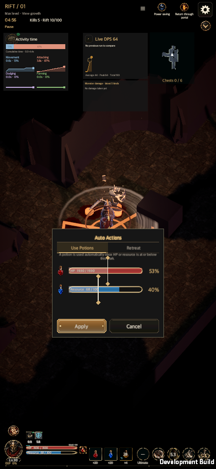
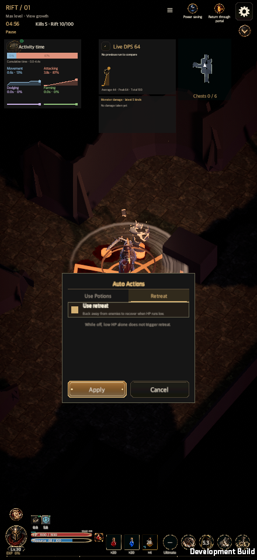
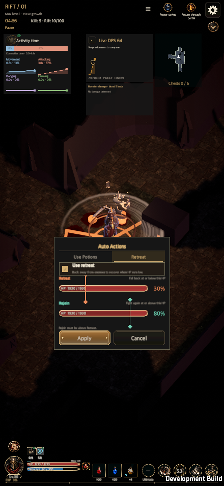
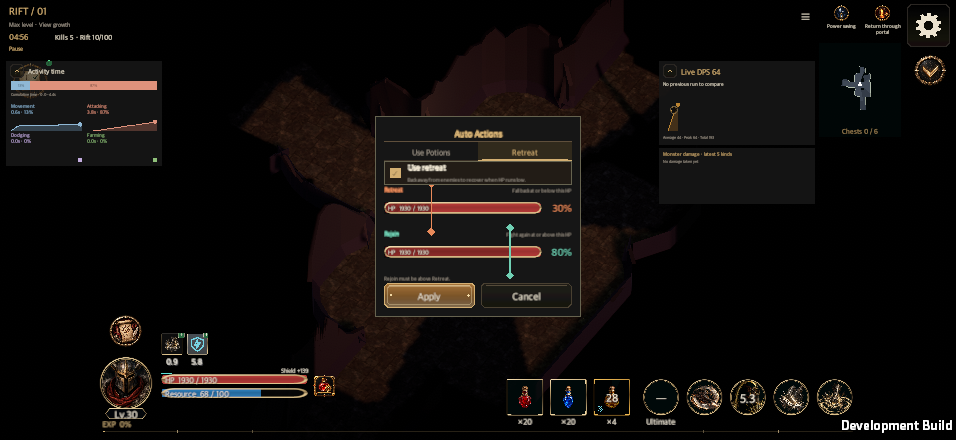
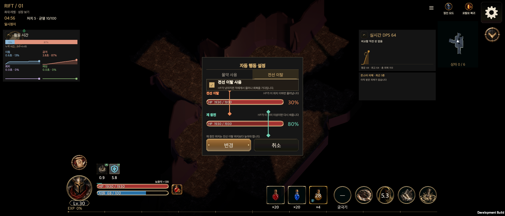

# Battle HUD quick edit (2026-10-09)

[한국어](Battle_Quick_Edit_20261009.md)

Hunt Edict, potions and skills can be changed from the battle HUD without opening a menu. The battle is paused while a panel is open and returns to its previous pause state on close. Ordinary rift battles only; tutorial, training, puzzle and comparison battles keep their existing paths.

- **Hunt Edict button** (above the seal): the combat position group (first engagement, default position, distance, orbit direction). One tap on a choice draws the hero's forecast walk (3 s, a detached simulation, `CombatSimulation.ForecastHeroPath`) on the floor; a second tap saves through `CommitHuntEdict`. Visibility follows `HuntEdictProgression.Direct`.
- **Potion settings button** (right of the HP/resource bars): drag bars for the HP and resource thresholds, saved with `변경` (`survival.potionHpPercent`, `potion.resourcePercent`, 0-100%).
- **Skill, ultimate and potion slots**: a tap lists the candidates (nothing opens when there are none); choosing one equips it (`ClassSkillTree.Equip` + `CommitHuntEdict`; potions use `SelectPotionSlot`). Holding fills a gauge after 0.3 s over 0.7 s and opens a centred details popup (`HoldPress`); the skill popup also changes the skill's Hunt Edict quick presets.
- **Decision**: potion slots could only change in town or at a portal checkpoint; changing them during battle is now allowed. A buff potion cannot be swapped while its effect runs.
- **Live combat log removed** from the battle screen (the records screens are unchanged). Two smokes now assert its absence. The panel code in `GameUI.CombatJournal.cs` remains but is no longer called.
- **Verified**: `HuntEdictQuickMenuTests` (8), HUD, localization and shared-UI tests, and `check_ui_contract.py --verify`. A test confirms the forecast ends where the battle actually walks after the same choice is saved.
- **macOS development-build smoke** (`RuntimeBattleQuickEditSmoke`, a copy of the graduated Warrior account, 440x956 / 956x440 / 1600x900): Hunt Edict save, potion thresholds save, skill equip, buff potion equip, hold gauge and popups, and no live combat log all pass. `RuntimeCombatJournalSmoke` (HUD only) passes too.
- **Not verified**: `RuntimeFirstPlayAcceptance`, real finger input and physical devices (macOS synthetic input only). Feature tiles use text, not icon art.

## Follow-up (2026-10-09)

- The potion threshold panel is redrawn from the real HUD HP/resource bar pieces (track, fill, border, same colours and labels). The fill is the current state, a gilded notch is the threshold, and the zone at or below it is lit.
- The portrait bottom HUD is larger: only in portrait the composition width shrinks, so the vitals and settings button area meets the potion area (`GlobalHudLayout`). Landscape is unchanged, and the "same composition on rotation" test now allows only the portrait close-up of the potion group.
- The potion settings button uses a new button-shaped painting (`menu-potion-settings`, made with Codex, `Docs/Art/PotionSettingsButton/`).

The integrated full Edit Mode result and focused failure repair are recorded in [Battle damage graphs](Damage_Graphs_20261010.en.md#integration-validation-2026-10-10). Five unapproved Edict icon candidates are preserved in `Docs/Art/EdictHudIcons/Candidates/` and are not loaded by the game.

## Auto Actions reference implementation (2026-10-11)

The potion popup uses a fixed-size `Auto Actions` card and `Potions / Retreat` tabs, retaining real HUD HP/resource bars and potion art. Both tabs share one draft and fixed Apply/Cancel actions. Switching tabs, resizing or changing safe-area insets preserves controls and draft values.

The added implementation specification resolves the initial design decisions. Retreat is available when `survival.lowHp`, `survival.lowHpPercent` and `survival.returnHpPercent` are all visible. These three options gain shared direct-edit permission after Rift 3 so saving works immediately; other detail gates remain. With only one available body, the tab bar is hidden. Locked retreat retains the original compact potion height.

The card uses a maximum width of 420, padding 18, title 34, tabs 40, bar rows 54, row gaps 16 and action buttons 52 units. With two tabs, its height is computed once from the larger body and remains fixed through tab and checkbox changes. `UiTheme` owns orange retreat and mint rejoin colours. The marks enforce the storage rule's minimum one-percent gap without pushing the other mark. An inverted OFF save corrects rejoin to `max(saved rejoin, retreat+1)` in the detached draft on opening. Only Apply saves the correction; Cancel preserves the original.

Apply validates both tabs together through the existing `CommitHuntEdict` transaction, avoiding invalid intermediate pairs. Failed saves retain the popup and draft. Cancel/backdrop dismissal preserves actual settings and restores the original pause.

Existing defense/escape/walking priorities remain, using the same save keys and combat actions. The off text specifies that low HP alone does not trigger retreat, because lethal response remains independent and still shares rejoin HP.

### Validation evidence (2026-10-11)

- Quick-menu/progression Edit Mode: 48/48 passed, including actual save/reload at Rift 3 while other detail options stay locked.
- UI contract: 15 regression checks passed. UI refresh validator passed.
- macOS development player: the existing battle quick-edit smoke passed with 59 captures. Only the validation code was adjusted to close the expected-error development console; affected potion acceptance was then rerun successfully with 29 captures on the same game UI source. KO/EN and 440×956, 956×440, 1600×900, 1600×1000 and 2100×900 were checked.
- Actual pointer drag, one-percent clamp without moving the other mark, fixed card size, shared draft, disk-save failure/retry/readback, cancel/pause restoration, inverted OFF draft correction, single-body disclosure, rotation and safe areas passed. The fixture is a newly generated synthetic account; no user save was copied.
- Full Edit Mode completed: 5,701 passed, two failed, and four authoring/measurement tools skipped. The unchanged boss landing sweep took 228 seconds, so its test-only timeout is now 300 seconds. The safe-area fixture now uses normal reservation inputs that fit small Editor Game Views. Only the two failed checks were rerun; both passed. Runtime UI/combat sources are unchanged, so the other completed checks and native proof are reused. Neither earlier interrupted run is counted as passed.
- Physical mobile input and the WebGL player were not checked in this task.

Build, input and screenshot hashes and coverage are in the [validation record](BattleQuickEditEvidence20261011/validation.json). The reference share token is not stored.

