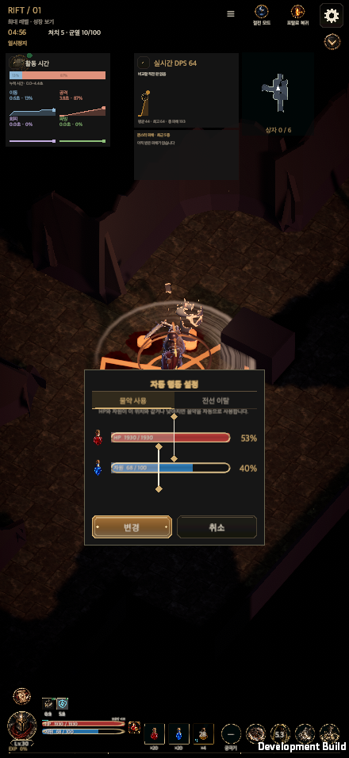
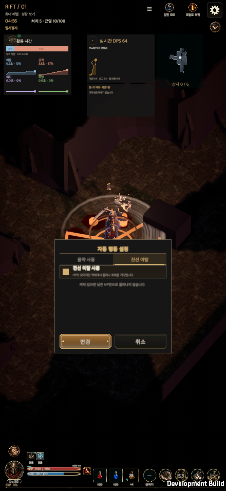
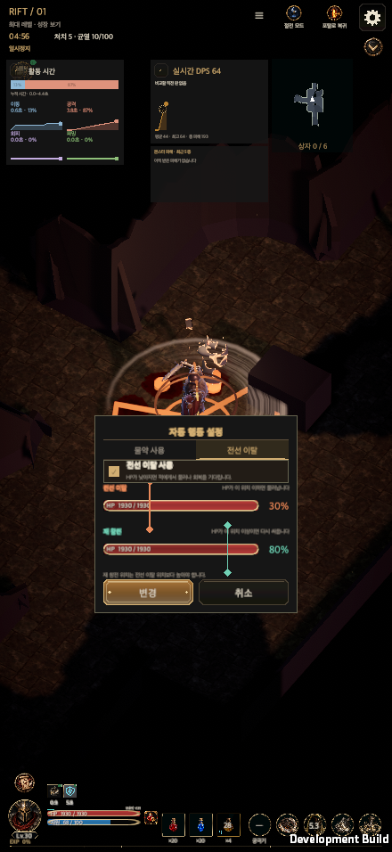

# 전투 HUD 빠른 편집 (2026-10-09)

[English](Battle_Quick_Edit_20261009.en.md)

전투 중 메뉴를 거치지 않고 HUD에서 사냥 칙령·물약·스킬을 바꾼다. 열려 있는 동안 전투는 일시정지되고, 닫으면 원래 상태로 돌아간다. 일반 균열 전투에서만 동작한다(튜토리얼·훈련·퍼즐·비교 전투는 기존 경로).

- **사냥 칙령 버튼**(인장 위): 전투 위치·거리 항목(첫 교전 위치, 기본 전투 위치, 희망 거리, 선회 방향). 선택지를 한 번 누르면 예상 이동(3초, 분리된 시뮬레이션 `CombatSimulation.ForecastHeroPath`)을 바닥에 그리고, 한 번 더 누르면 `CommitHuntEdict`로 저장한다. 공개 여부는 `HuntEdictProgression.Direct`를 따른다.
- **물약 설정 버튼**(HP·자원 바 오른쪽): HP·자원 기준을 드래그 바로 지정하고 `변경`으로 저장(`survival.potionHpPercent`, `potion.resourcePercent`, 0~100%).
- **스킬·궁극기·물약 칸**: 짧게 누르면 후보 목록(없으면 열리지 않음), 후보를 누르면 장착(`ClassSkillTree.Equip` + `CommitHuntEdict`, 물약은 `SelectPotionSlot`). 0.3초 뒤 게이지가 0.7초간 차면 중앙 상세 팝업(`HoldPress`). 스킬 팝업에서는 사냥 칙령 빠른 프리셋도 바꾼다.
- **결정**: 물약 칸은 원래 마을·포탈 체크포인트에서만 바꿀 수 있었으나, 전투 중 교체를 허용했다. 보조 물약은 효과가 진행 중이면 교체할 수 없다.
- **전투 로그 제거**: 전투 화면의 실시간 로그 줄·버튼을 뺐다(기록 화면은 그대로). 해당 스모크 두 개를 "로그 없음" 확인으로 바꿨다. `GameUI.CombatJournal.cs`의 패널 코드는 호출되지 않는 상태로 남아 있다.
- **검증**: `HuntEdictQuickMenuTests` 8개, HUD·지역화·공통 UI 테스트, `check_ui_contract.py --verify` 통과. 예상 경로는 같은 선택을 저장한 뒤의 실제 경로와 일치함을 테스트로 확인했다.
- **macOS 개발 빌드 스모크**(`RuntimeBattleQuickEditSmoke`, 정리된 전사 계정 복사본, 440×956·956×440·1600×900): 칙령 저장, 물약 기준 저장, 스킬 장착, 보조 물약 장착, 길게 누르기 게이지·팝업, 전투 로그 없음을 통과. `RuntimeCombatJournalSmoke`(HUD 전용)도 통과.
- **미검증**: `RuntimeFirstPlayAcceptance`, 실제 손가락 입력·실기기(macOS 합성 입력만 확인). 항목 타일은 아이콘 그림 없이 글자만 쓴다.

## 후속 조정 (2026-10-09)

- 물약 기준 패널을 실제 HUD의 HP·자원 바 부품(트랙·채움·테두리·같은 색·같은 라벨)으로 다시 그렸다. 채움은 지금 상태, 금빛 눈금이 기준, 눈금 이하는 밝게 칠한다.
- 세로 화면의 하단 HUD를 키웠다: 세로에서만 구성 폭을 줄여 HP 바·설정 버튼 영역과 물약 영역이 맞닿는다(`GlobalHudLayout`). 가로 구성은 그대로이고, "회전해도 구성 불변" 테스트는 세로의 물약 묶음 이동만 허용하도록 바꿨다.
- 물약 설정 버튼을 버튼 모양의 새 그림(`menu-potion-settings`, Codex 생성, `Docs/Art/PotionSettingsButton/`)으로 바꿨다.

전체 Edit Mode 통합 결과와 실패 항목 보완은 [전투 피해 그래프](Damage_Graphs_20261010.md#통합-검사-2026-10-10)에 기록했다. 미승인 칙령 아이콘 후보 5장은 `Docs/Art/EdictHudIcons/Candidates/`에 보관하며 게임에서 불러오지 않는다.

## 자동 행동 설정 시안 반영 (2026-10-11)

물약 팝업은 고정 크기의 `자동 행동 설정` 카드와 `물약 사용 / 전선 이탈` 탭을 쓴다. 현재 HP·직업 자원·물약 그림은 기존 HUD 부품이다. 두 탭은 하나의 편집본과 고정 변경·취소 버튼을 공유한다. 탭·해상도·안전 영역 변화로 편집값이나 컨트롤을 재생성하지 않는다.

추가 개발 명세의 확정안을 따른다. `survival.lowHp`, `survival.lowHpPercent`, `survival.returnHpPercent`가 모두 공개되면 전선 이탈을 제공한다. 균열 3단계 해금 직후 저장할 수 있도록 이 세 항목을 공통 직접 편집 권한에 포함하고, 다른 상세 항목의 제한은 유지한다. 둘 중 하나만 열렸으면 탭 바를 숨기고 해당 내용만 표시한다. 전선 이탈이 잠긴 경우 기존 물약 창 높이를 유지한다.

카드 폭 최대 420, 여백 18, 제목 34, 탭 40, 바 행 54, 행 간격 16, 행동 버튼 52 단위를 사용한다. 두 탭이 있으면 더 큰 본문을 기준으로 높이를 한 번 정하고 탭·체크 전환 중 유지한다. 주황색 후퇴·민트색 복귀 색은 `UiTheme` 소유다. 이탈과 재참전 기준은 저장 규칙과 같은 최소 1% 간격이며, 상대 바를 밀지 않는다. 꺼짐 상태에서 저장된 역전 값은 열 때 재참전을 `max(기존 값, 이탈+1)`로 초안에만 보정한다. 변경을 눌러야 저장되며 취소하면 기존 값이 유지된다.

변경은 두 탭을 한 번에 검증해 기존 `CommitHuntEdict`로 저장한다. 유효한 후퇴·복귀 쌍의 중간 상태 때문에 저장을 거부하지 않는다. 저장 실패 때 팝업·편집본을 유지하고 취소·바깥 클릭은 실제 값을 바꾸지 않으며 원래 일시정지를 복원한다.

새 저장 키나 전투 행동은 추가하지 않았다. 기존 긴급 행동 순서(방어기·회피기·보행)는 그대로다. 꺼짐 안내는 다른 치명 대응까지 끈다고 오해하지 않도록 “낮은 HP만으로 물러나지 않습니다”로 표시한다. 복귀 HP는 기존 치명 대응에도 공유된다.

### 검증 근거 (2026-10-11)

- 빠른 편집·진행 권한 Edit Mode 48/48 통과. 균열 3단계부터 실제 저장·재로드를 확인하고, 다른 상세 설정의 잠금은 유지한다.
- UI 계약·회귀 15개와 UI 갱신 검사 통과.
- macOS 개발 플레이어: 기존 전투 빠른 편집 스모크 통과(59장). 같은 게임 UI 소스에서 오류 콘솔을 닫는 검증 코드만 보완한 뒤, 영향받은 물약 팝업 범위를 다시 검증하여 29장과 성공 종료를 확보했다. 한국어·영어, 440×956·956×440·1600×900·1600×1000·2100×900을 확인했다.
- 실제 포인터 드래그, 상대 바를 밀지 않는 1% 간격, 카드 크기 고정, 초안 유지, 저장 실패·재시도·디스크 재로드, 취소·일시정지 복원, 꺼짐 역전 값의 초안 보정, 단독 탭·미해금 상태, 회전·안전 영역을 확인했다. 테스트 계정은 새 합성 계정이며 사용자 세이브를 복사하지 않았다.
- 전체 Edit Mode 완료: 5,701개 통과, 2개 실패, 작성·측정 도구 4개 제외. 228초 걸린 기존 보스 착지 검사의 제한을 300초로 조정하고, 안전 영역 검사의 고정 픽셀 입력을 작은 Game View에서도 일반 여백으로 검사되도록 보완했다. 실패한 두 항목만 재검사하여 2/2 통과했다. 게임 UI·전투 소스는 그대로여서 기존 통과 결과와 네이티브 검증을 재사용했다. 앞선 두 중단 실행은 통과로 계산하지 않는다.
- 모바일 실기기와 WebGL 플레이어는 이번 작업에서 확인하지 않았다.

빌드·입력·캡처 해시와 범위는 [검증 기록](BattleQuickEditEvidence20261011/validation.json)에 남긴다. 공유 시안의 접근 토큰은 저장하지 않는다.

영어 및 가로·PC 대표 화면은 [영어 기록](Battle_Quick_Edit_20261009.en.md#validation-evidence-2026-10-11)에 있다.
