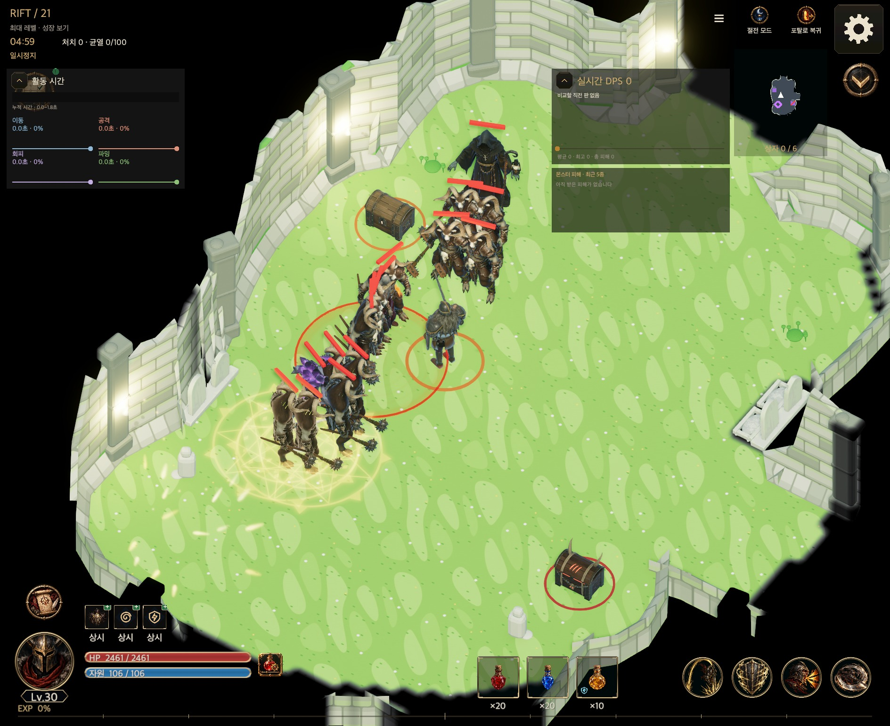

# 균열 필드 캐주얼 아트 적용 — 2026-10-14

[English](Casual_Fields_20261014.en.md)

확인일: 2026-10-15

작성일: 2026-10-14

F4 초원을 대표로 확인한 뒤 F0~F5의 실제 게임 리소스·조명·안개·입자를 밝은 StyleD 팔레트로 연결했다. 생성 시드, 방 배치, 장애물 판정, AI, 전투·보상·저장 키는 변경하지 않았다. 보스 전용 아레나·훈련장·레거시 링·마을·몬스터 파이프라인은 적용 범위 밖이다.

## 실제 화면

각 링크는 macOS Unity Editor 6000.6.0f1의 실제 게임 화면이다. 자연 생성 시드로 입장한 뒤, 가독성 확인을 위해 영웅을 살아 있는 적 무리 옆의 통행 가능한 위치에 배치했다. 실제 전투 틱으로 발생한 예고를 일시정지하여 캡처했다. 자연 성장·밸런스·실기기 성능의 근거는 아니다. 미탐색 카메라 배경은 검정으로 유지했다.

| 필드 | 팔레트 | 진입 직후 | 실제 공격 예고 | 시드 |
| --- | --- | --- | --- | --- |
| F0 묘지 | 밝은 돌·이끼·꽃 | [진입](CasualFieldEvidence20261014/F0-entry.jpg) | [예고](CasualFieldEvidence20261014/F0-telegraph.jpg) | 19 |
| F1 성채 | 크림색 돌·따뜻한 햇빛 | [진입](CasualFieldEvidence20261014/F1-entry.jpg) | [예고](CasualFieldEvidence20261014/F1-telegraph.jpg) | 1 |
| F2 사막 | 따뜻한 모래·하늘색 | [진입](CasualFieldEvidence20261014/F2-entry.jpg) | [예고](CasualFieldEvidence20261014/F2-telegraph.jpg) | 3 |
| F3 동굴 | 보라색 돌·밝은 수정 | [진입](CasualFieldEvidence20261014/F3-entry.jpg) | [예고](CasualFieldEvidence20261014/F3-telegraph.jpg) | 16 |
| F4 초원 | 풀 초록·크림색 벽·꽃가루 | [진입](CasualFieldEvidence20261014/F4-entry.jpg) | [예고](CasualFieldEvidence20261014/F4-telegraph.jpg) | 17 |
| F5 고원 | 밝은 눈·옅은 파랑 | [진입](CasualFieldEvidence20261014/F5-entry.jpg) | [예고](CasualFieldEvidence20261014/F5-telegraph.jpg) | 2 |

모든 캡처는 1889×1543이며 붉은 예고와 영웅을 구분할 수 있다. F5 눈의 큰 파란 얼룩은 설치 과정에서 대비를 낮췄다. 새 키트에 없는 묘석·석관·화로 등은 방 템플릿 가족의 재색칠한 기존 모델을 사용한다. 실제 메시의 bounds를 기존 장애물 footprint·height에 맞추는 공통 경로를 유지한다.

## 소유 경로와 용량

- `FieldLook.cs`, `WorldFx.Persistent.cs`: 6개 필드의 낮 조명·옅은 안개·약한 비네트·꽃가루/잎/수정 입자/눈. `Town`과 `Legacy` 프리셋은 유지한다.
- `WorldView.Rift.cs`, `WorldView.Props.cs`: 공통 타일·장애물 연결, 구형 사각 튜토리얼 통로의 밝은 바닥, 필드 모델 우선 및 템플릿 가족 모델 재사용.
- `Resources/World/Fields/F0..F5`: 기존 이름과 GUID를 유지하는 교체. `_A`의 알파는 무광 smoothness 26/255이며 모든 `_N`은 평평한 tangent normal이다.
- `ResourceTextureBudget.cs`: F0~F5별 512px 플랫폼 예산을 명시한다. 원본 팔레트 아틀라스는 64px, 상수 노멀은 4px이다.
- [설치 도구](../../tools/art3d/install_casual_fields.py): main에 보존된 절차 제작 키트를 설치하고 누락 소품의 색과 노멀을 맞춘다. 모델·이미지 외부 생성 API와 새 패키지는 사용하지 않았다.

[실측과 해시](CasualFieldEvidence20261014/asset-checks.json): 필드 모델·텍스처·manifest 소스는 47,237,697 → 4,362,081 bytes, **40.9 MiB 감소**. F3~F5 신규 리소스도 포함한 값이며 APK·웹·플레이어 설치 크기 수치는 아니다. 기존 GUID 168개를 보존했고 6개 필드 재설치는 바이트 단위로 동일하다. 최종 리소스는 모델 81개와 텍스처 198개다. 어두운 원본은 삭제 대신 Git 이력에서 복구할 수 있다.

## 튜토리얼 문구 점검

`GuideTutorial`, `CombatSimulation.Guide`, `Tutorials`, `TutorialChapters`, `FirstPlayGuide`, `GameUI.Tutorial*`, `GameUI.Guide*`, `TutorialCinematic`, `WorldView.Prologue` 및 `Localization/en.txt`를 점검했다. 튜토리얼 안내·토스트·현재 여신 대사는 화면의 어두움을 전제하지 않아 유지했다. 안내 그림의 텍스트는 같은 로컬라이즈 경로로 표시하며 별도의 분위기 설명 이미지를 추가하지 않았다.

| 기존 키/소유 위치 | 표시 수정 |
| --- | --- |
| 프롤로그 `Surrounded` — “여기까지인가… 이 어둠 속에서…” | “이곳에서”; EN도 장소를 가리키도록 수정 |

한국어 문장 자체가 기존 번역 키이므로 프롤로그의 원본 키를 바꾸지 않고 `Loc.T`의 한국어 표시와 영어 번역을 보정했다. 처음 점검한 퍼즐 hook 4개는 최신 main의 PR #132에서 해당 튜토리얼과 함께 폐기됐다. 병합 시 폐기된 코드·데이터·번역을 되살리지 않고 표시 보정과 회귀 사례도 제거했다. 현재 적용되는 문구 보정은 위 프롤로그 1개다. “잊힌 묘지”, 몬스터/아이템의 “무덤”, 절전 화면의 어두워짐은 장소·정체성·기능을 가리켜 유지했다. 관련 회귀 검사는 기존 키 보존, 한·영 표시와 한국어 fallback을 확인한다.

## 검증 상태

- 대표 F4 관련 EditMode 17/17 통과. 이후 공통 모델 재사용 보완은 6개 필드 실제 화면·컴파일로 확인했고 최종 검사에 포함한다.
- 최종 6개 필드 진입/전투 캡처 12장, 모든 캡처의 검정 배경·실제 windup assertion 통과.
- 설치 도구 self-check, 재설치 동일성, 기존 GUID 보존 및 diff 검사 통과.
- [최종 전체 EditMode](CasualFieldEvidence20261014/editmode-final-summary.json): `bd785e8e`에서 5,778건 통과·실패 0·기존 진단 3건 제외, 6,007.41초. 아트 회귀 18건도 모두 통과했다. 이후 최신 main에서 필드 아트·생성기·로더·Unity/패키지 입력이 바뀌지 않아 이 결과와 화면 12장을 재사용했다.
- [최신 main 추가 검사](CasualFieldEvidence20261014/latest-main-focused-summary.json): PR #132가 바꾼 저장·가이드·전투·장비·문구·UI 소유자만 698건 검사했다. 697건 통과, 기존 퍼즐 저장 전사의 가이드 입장 1건 실패를 발견했다. 기존 `mapHero`가 남아 초기 칙령 보정이 차단되는 문제를 공통 검증에서 수정했다. 필수 가이드의 소유 전사에게 정확한 초기 설정만 허용하며 잠긴 다른 옵션은 유지한다.
- [직접 영향 회귀](CasualFieldEvidence20261014/guide-migration-regression-summary.json): 수정 후 관련 120/120 통과. 기존 저장 3개 직업의 불러오기·전환, 새/기존 소유자의 잠긴 설정 차단, 가이드 진행 및 저장 경계를 확인했다. 나머지 성공 사례와 전체 검사는 반복하지 않았다.
- 최종 UI 계약·회귀 [15/15](CasualFieldEvidence20261014/ui-contract-delivery-summary.json) 통과. 저장 갱신 정적 검사(14개 binding, UI 소스 184개)도 통과했다. 공통 검증 수정은 UI 계약 입력에 포함되지 않으며, 변경된 개발용 fixture 입력만 최종 확인했다. [재사용 범위](CasualFieldEvidence20261014/validation-reuse.json).
- [macOS 개발 플레이어](CasualFieldEvidence20261014/native-summary.json): 같은 최종 바이너리로 필드 최초 실행·별도 프로세스 재시작과 새 가이드 스모크를 통과했다. 필드 1280×720에서 실제 신단 사용, 현행 칙령 창의 선택/저장, 잔향 4마리 자동 처치(7.60초), 잔향 무보상과 상자 보상 1회 지급을 확인했다. 지도·HP·RNG·적 상태·신단 지속시간을 보존했다. [필드 결과](CasualFieldEvidence20261014/native-field/runtime-field-smoke.txt), [상자 개봉 화면](CasualFieldEvidence20261014/native-field/07-cursed-chest-opened.png).
- [가이드 결과](CasualFieldEvidence20261014/native-guide/runtime-guide-tutorial-smoke.txt): 한국어 440×956에서 새 게스트의 전사 진입, 여신 대화, 소용돌이·위치·대상·보물·회수 수업, 실제 금화/장비 획득과 졸업 1회 지급·마을 도착을 통과했다. 합성 EventSystem 입력과 실제 전투 틱 가속을 사용한 macOS 검사이며 실기기 터치나 자연 플레이 속도·이해도 검사는 아니다. 가이드 화면 73장을 보존했다.

에디터 첫 검색 인덱스 예외, 비동기 입장·셰이더 컴파일·재사용 체크포인트·적 배치로 인한 초기 캡처 실패 기록은 작업 검증 폴더에 보존했다. 캡처 도구는 비동기 입장을 기다리고, 완료된 셰이더와 독립된 fixture로 실행한다. 실패 또는 미완성 대체 화면은 위 링크의 최종 근거에 포함하지 않았다.

구형 필드 스모크를 현행 D4에 연결하면서 칙령 모드, 공통 편집기 진입, 발견물/재정비 우선순위를 수정했다. 실패한 체크포인트를 짧은 재현 검사로 분리한 뒤 신단·잔향 처치·상자 개봉 전체 흐름을 1/1 통과했고 실제 플레이어에서 다시 확인했다. 적 HP·12초 제한·보상·재시작 비교 조건은 완화하지 않았다. 개발 바이너리는 fixture 수정으로 5회 빌드했으며 실패 근거·재현 소스는 [진단 묶음](CasualFieldEvidence20261014/field-fixture-diagnostics.zip)에 보존했다. 통과한 전체/관련 검사는 재실행하지 않았다.

모바일 실기기, 웹 실행, 전후 바이너리 반복 성능 및 APK 크기는 미검증이다. 남은 필드는 없으며 병합 후보 검증을 완료했다. [PR #128](https://github.com/dakrdong/HELLSCRIPT/pull/128)에서 main 통합 상태를 확인할 수 있다. 위키 검증·Pages 게시와 산출물 보존/정리 근거는 최종 배포 기록에 남긴다.
