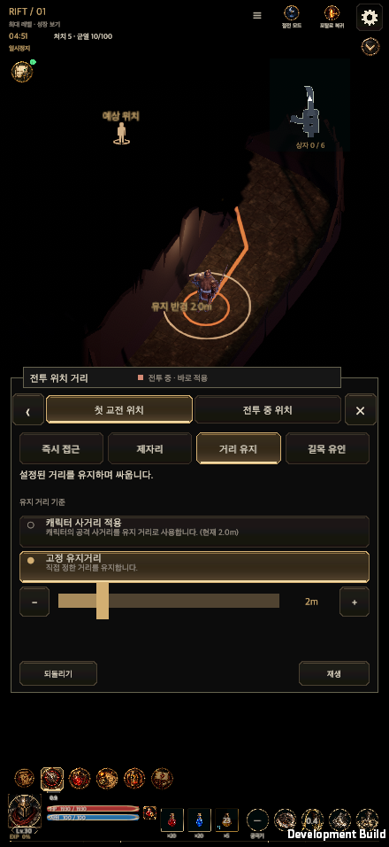
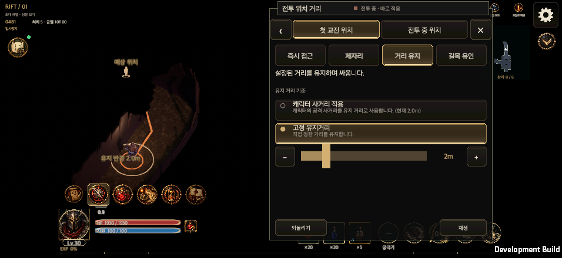
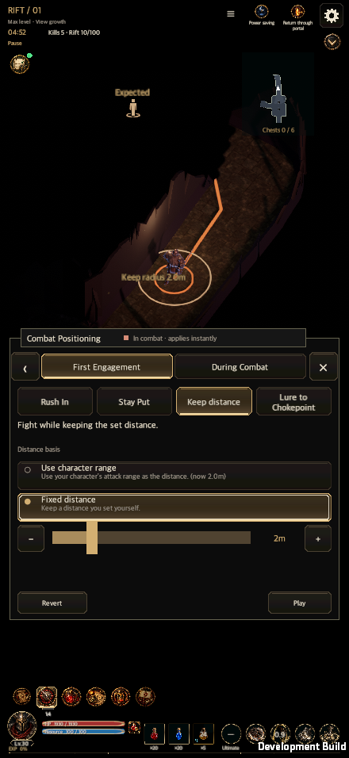
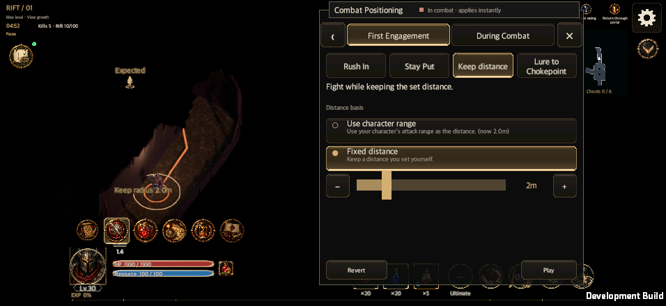
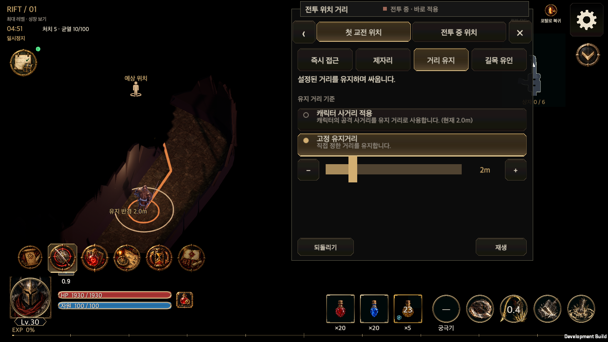

# 전투 위치·거리 패널과 위치 AI (2026-10-11)

전투 HUD의 칙령 → 전투 위치 거리 묶음을 시안의 두 탭으로 구성한다. 첫 교전은 즉시 접근·제자리·거리 유지·길목 유인, 전투 중은 무리 중심·제자리·거리 유지·가장자리다. 두 탭의 제자리와 거리 유지 버튼은 같은 칸에 있다. 하위 선택은 설명 영역에 표시하고, 되돌리기·재생과 탐색 버튼은 고정한다.

## 화면과 저장

기존 `GameUI.EdictSheet`의 어댑터이며 `UiSafeArea`, `UiTheme`, `UiFonts`, 기존 빠른 편집 Canvas와 거래를 사용한다. 가로에서는 오른쪽 설정 버튼을 피한다. 창의 높이는 선택에 따라 달라지지 않고, 화면 회전 때 열려 있는 탭·되돌리기 이력을 보존해 다시 배치한다. 거리 입력은 0–10m, 0.5m 단위다. 드래그 중에는 전장 반경만 갱신하고 포인터를 놓을 때 `SheetApply` → `GameStore.CommitHuntEdict`로 저장한다. 내 영역 유지는 전투 중 탭에 둔다.

전역 저장 v6은 v5의 ID와 직렬화 순서를 그대로 두고 다음 네 옵션을 끝에 추가한다.

| ID | 새 기본값 |
| --- | --- |
| `position.engageApproach` | `SKILL` |
| `position.engageDistanceSource` | `BASIC_RANGE` |
| `position.engageDistance` | `2` |
| `position.lureMode` | `NEARBY` |

v1–v5 원본과 HED2·HED3·HED4·HED5 공유 코드는 이전 버전의 엄격한 순서·필드 검사 후 v6으로 변환한다. `position.mode=ORBIT`만 `DISTANCE`로 옮기고, 숨겨진 `position.clockwise` 값은 보존한다. 영웅 설정, `legacyEdict`, 저장 프리셋은 공용 canonical 경로로 변환한다. 첫 교전 거리와 전투 중 거리 기준·값은 독립적이다.

## 실제 전투

기본 공격 사거리는 `ClassSkills.BasicReach` 하나를 사용한다(전사 2m, 궁수·마법사 10m). 걷기 접근은 첫 교전 동안 공격용 도약과 그 도약을 전제로 한 지원기 예측을 막는다. 긴급 생존 회피는 유지한다. 첫 교전 거리 유지는 지정 거리의 ±0.75m 안에서는 머물고, 멀면 다가가며 가까우면 물러난다.

길목 후보는 좁은 통로의 폭, 연결된 문, 교차점 입구에서 만든다. 밝혀진 후보만 거리 → x → y 순서로 고른다. KNOWN은 가장 가까운 밝혀진 길목, SCOUT은 알려진 길목이 없을 때 미방문 출구를 탐색해 길목을 발견하면 진입, NEARBY는 8m 안에 후보가 없으면 제자리에서 응전한다. 도착하면 이동해 온 쪽을 바라보고 기다린다. 피격되거나 상한 시간이 지나면 첫 교전 단계가 끝난다. 무리 중심과 가장자리는 현재 관측한 대상의 5m 안에 있는 적만 사용한다. 중심은 무게중심 가까운 안전한 빈자리, 가장자리는 무게중심에서 가장 먼 적의 바깥쪽 2m 안으로 붙는다. 저장·거래 검증, 위험·충돌·경로 검사는 유지한다.

## 전장 표시와 아이콘

예상 위치는 분리된 전투 사본의 `ForecastHeroPath` 끝점이다. 금색 점선 고리·예상 위치 아이콘, 영웅 중심 유지 반경·사거리 표기, 밝혀진 길목·탐색 방향·근처 범위 밖 표기, 관측한 적 무리의 빨간 고리·아이콘을 표시한다. 선·고리·스프라이트·공용 월드 라벨은 한 번 만들고 재사용한다. 닫기와 재생은 예보를 숨긴다.

제공된 PNG 네 개는 바이트 그대로 `Resources/Art/HuntEdict/Position/`에 등록한다. [아이콘 기록](../Art/EdictPosition/edict-position-icons-manifest.json)에 원본 해시, 알파 수치와 `model: unknown`, `productionApproved: false`를 보존한다. 모바일 128px ASTC 4×4, 데스크톱 256px 제한을 추가한다. 투명 영역의 알파 16/255 이하 점은 원본을 수정하지 않는다.

## 결과 차이와 확인할 값

이전 기본값은 선회였고 새 기본값은 2m 고정 거리 유지다. 기본 추천 칙령으로 서 있는 적과 적정 거리에 도달한 뒤에는 계속 원을 돌지 않는다. 따라서 이동 거리·사선 변경·잔상 누적과 그에 의존하는 궁수 패시브 측정값은 달라질 수 있다. `mobile-crossfire` 프리셋 ID는 저장 호환성을 위해 유지하되 표시·설명은 4m 거리 유지로 고친다. 거리 조절 중의 실제 이동만 이동 효과를 만든다.

길목 폭 4m, 근처 반경 8m, 유인 상한 10초는 계획의 초안 값을 명명된 상수로 적용했다. 제작자가 길목 메타데이터나 다른 수치를 확정하면 이 세 값과 관련 회귀 검사를 함께 갱신한다. 거리 0도 저장할 수 있으나 적과 영웅의 기존 충돌 여유는 유지한다.

첫 교전 접근은 전투 중 거리 값과 관계없이 기본 공격 사거리에서 멈춘다. 제자리는 사거리 밖 대상에도 접근하지 않고, 가장자리는 바깥 자리에 도착한 뒤 선회하지 않는다. 이에 따라 기존 자동 접근·선회를 전제로 한 스킬 검사와 퍼즐 입력도 접근·회피 선택을 명시하도록 바꿨다. 특히 가장자리만 선택해서 위험 공격을 계속 피하던 이전 퍼즐 판정은 새 동작에 해당하지 않는다.

동일 조건의 비교는 레벨 40·직업 스킬 1등급·아이템 레벨 30·세트/전설 장비 없음·적 무리·20초·시드 2개다. 세 빌드마다 기본 설정과 패시브 3개를 하나씩 뺀 경우를 측정하여 이전/이후 각각 24개 표본을 남겼다.

| 기본 추천 빌드 | 이전 평균 피해 | 이후 평균 피해 | 차이 | 생존 |
| --- | ---: | ---: | ---: | --- |
| 전사 `BUILD_REF_SW01` | 9,184.2 | 9,509.1 | +3.5% | 2/2 → 2/2 |
| 궁수 `BUILD_REF_SA01` | 1,858.6 | 1,852.2 | −0.3% | 2/2 → 2/2 |
| 마법사 `BUILD_REF_SM03` | 13,882.7 | 13,462.2 | −3.0% | 2/2 → 2/2 |

패시브를 하나씩 뺀 대응 표본과의 피해 차이는 AP09 54.5→60.8, MP01 2,364.5→2,350.6, MP14 −70.0→−207.9였다. 위치와 적의 움직임에 의존하는 비교값이며 전체 밸런스의 결론으로 확대하지 않는다. 원시 결과: [이전](EdictPositionEvidence20261011/passive-before.json), [이후](EdictPositionEvidence20261011/passive-after.json).

전체 검사에서 발견한 연결 문제는 공통 경로에서 수정했다. 전투 중 사거리 기준은 실제 기본 공격 사거리 안까지 접근한다. 구버전 단순화 가져오기도 v1부터의 엄격한 마이그레이션을 거친다. 첫 안내 튜토리얼은 사거리 기준 거리 유지를, 전사 퍼즐 7단계는 무리 중심 위치를 명시한다. 저장과 회전 후 키보드 선택도 복원한다. 철벽의 피격 대비 예시는 임박한 원거리 공격으로 시연한다. 멀리 예고된 지면 공격에는 보호막 판단 시점 전에 보행 회피를 선택할 수 있다.

퍼즐 15단계의 새 중심 이동에서는 전사가 직접 공격 회피를 끄고도 누적 HP 피해 526(최대 HP 780)을 입으며 생존했고, 마법사는 범위 공격 회피를 끄고 누적 피해 306(최대 HP 390)을 입으며 생존했다. 모든 회피를 켠 대응 표본의 누적 HP 피해는 각각 0이었다. 회피 하나를 끈 모든 조합이 반드시 죽는다는 이전 검사 가정은 해당하지 않으며, 실제 피해와 종료 결과를 함께 검사한다.

## 검증 기록

main 통합 뒤 전체 Edit Mode 5,742개를 한 번 실행했다(성공 5,722, 실패 16, 명시적 건너뜀 4). 실패한 연결 문제를 수정한 뒤, 기존 실패 16개와 직접 영향을 받는 범위·새 회귀 검사를 합친 419개가 모두 통과했다. 변경하지 않은 성공 결과는 재사용했다. 위의 패시브 24개 표본도 최종 전투 소스에서 동일한 결과를 확인했다. 공용 UI 계약 15개 회귀 검사와 갱신 정적 검사(14개 바인딩/176개 소스)가 통과했다.

macOS 개발 빌드는 실제 저장된 사냥을 정상 재개했다. 최종 위치 미리보기는 한국어·영어 각각 440×956·956×440·1600×900·1600×1000·2100×900의 10개 화면에서 저장·되돌리기·회전·키보드 선택·고정 높이·영웅/예상 끝점/라벨 표시·재생/닫기 복원 검사를 모두 통과했다(종료 0, 캡처 31장). 실제 캡처에서 발견한 패널·그래프·상하단 HUD 겹침은 기존 월드 카메라의 배치와 범위로 해결했다. 그래프는 미리보기 동안만 숨기고 재생·닫기·절전·페이지 이동에서 원래 상태로 복원한다.

나머지 4개 화면의 패널과 실제 외부 클릭 재검사는 종료 0·캡처 13장으로 통과했다. 영어 재생 버튼은 장비 접두어의 Renewal과 구분해 공통 Play/Pause 문구를 사용하며, 영어 세로·가로에서 별도 재검사했다(종료 0·캡처 5장). 물약 10개 화면·스킬/물약 장착 등 변경하지 않은 성공 결과는 재사용했다. 검사 범위와 소스 해시는 [검증 요약](EdictPositionEvidence20261011/validation-summary.json)에 남겼다. macOS 결과를 iPhone·Android 실기기 결과로 간주하지 않는다. WebGL 게임 플레이어와 운영 서버 연동은 이번 검사 범위에 포함하지 않았다.

실제 개발 플레이어 화면:

증거와 임시 산출물은 작업 폴더 `validation-codex/artifact-lifecycle.json`이 소유·경로·해시·보존 상태를 기록한다. 원본·소스·검사 로그·화면 증거를 보존하며, 영구 삭제는 승인 전 실행하지 않는다.
