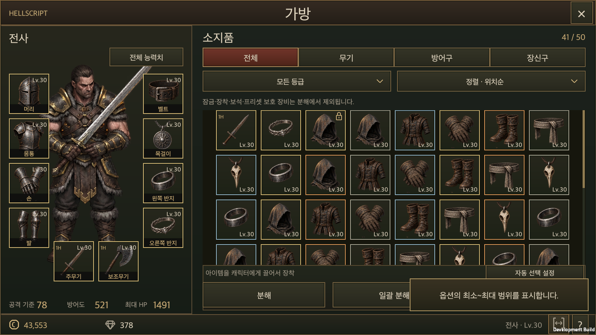
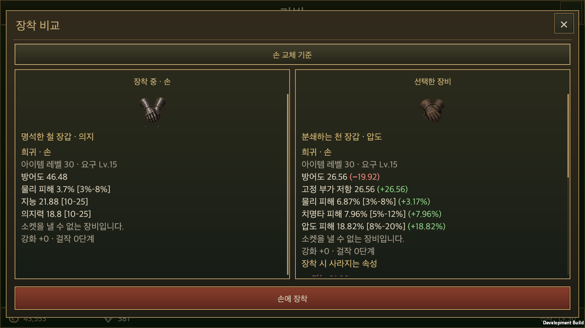
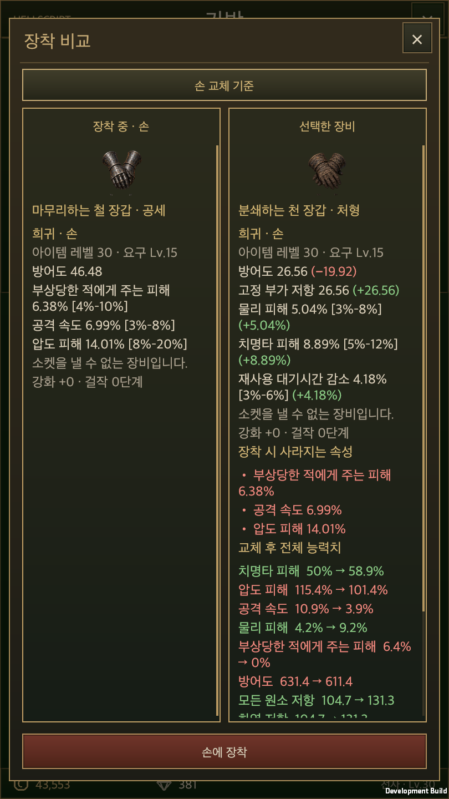
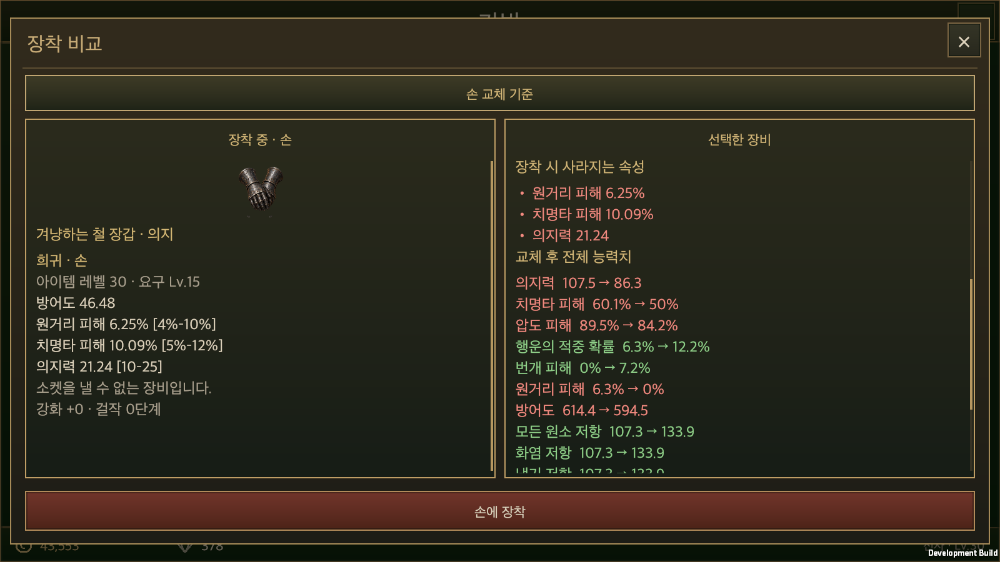
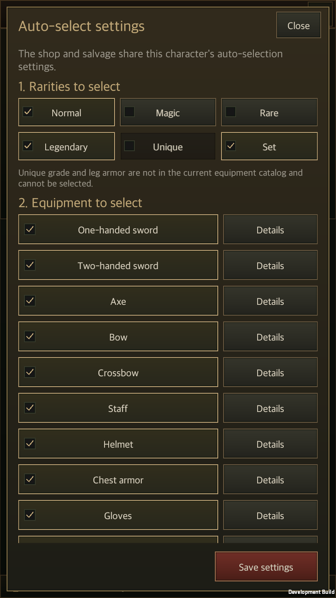
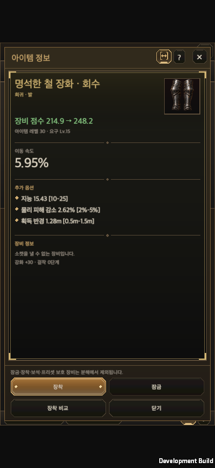
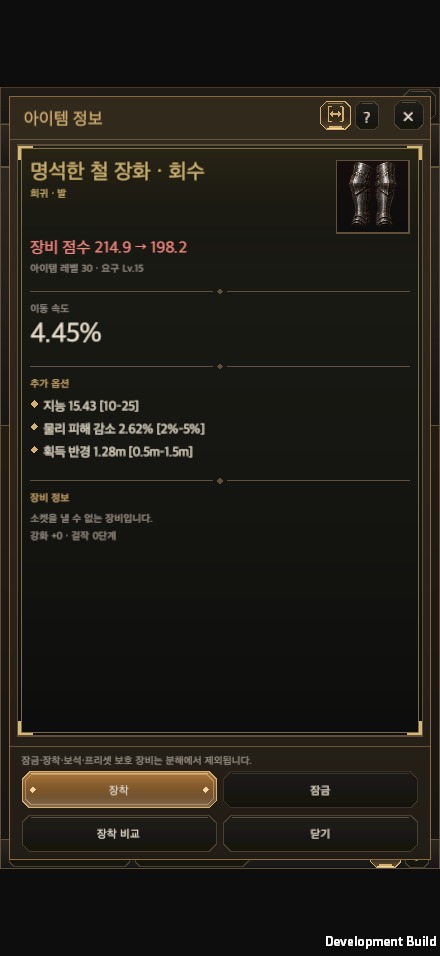
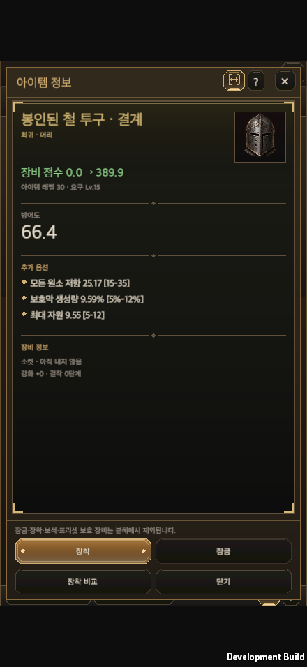
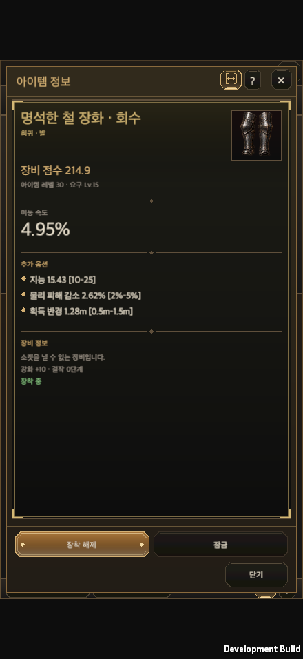
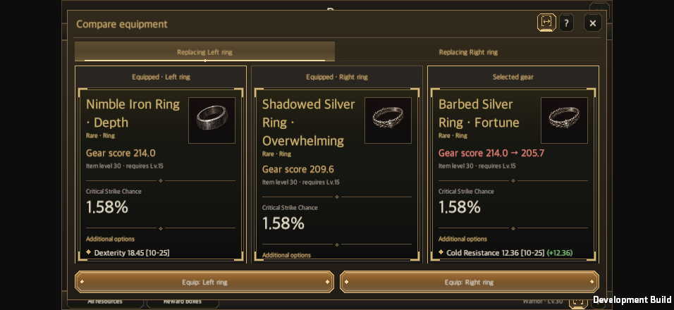

# Shared equipment comparison and salvage selection

Updated: 2026-10-02 · First written: 2026-09-22 · [한국어](Equipment_Comparison.md) · [Display contract](../Design/Equipment_Comparison_Rules.en.md)

Inventory, storage and merchant comparisons previously used separate ordering and calculation paths. A shared model and renderer now put equipped gear left and the candidate right, append candidate deltas, and list missing outgoing properties in red. Repository instructions require the same contract for future content.

## Ownership

| Concern | Owner |
| --- | --- |
| Properties and roll ranges | `ItemComparison.Properties` reads actual bases, affixes, quality and gems. |
| Outgoing equipment | `ItemComparison.Preview` runs `EquipmentSlots.Plan` on copies. |
| Deltas, lost properties and resulting attributes | `ItemTooltip.Lines` supplies consistent order, units, colors and wording. |
| Paired cards, target selection and scrolling | `EquipmentComparisonView` occupies a fixed region supplied by each content window. |
| Equipping and transactions | Existing `GameStore`, `EquipmentSlots`, storage and merchant services. |

Consumers include native inventory, storage comparison, merchant buy/sell/buyback, gambling reward comparison, legacy equipment details and training candidates. Single-item reward details omit context-free deltas and offer Compare to open the shared view. Training passes its frozen runes and chosen destination.

Each occupied ring remains visible while its replacement baseline can be selected without resizing the window. Two-handed and incompatible-offhand removal follows the real equipment plan and never double-counts an instance. Item-local differences remain distinct from resulting character values.

## Shared shop and salvage settings

The existing `Hero.equipmentShop.auto` remains the save owner. `ShopAutoSelect.MatchesFilters` evaluates rarity AND equipment type plus attribute exclusions. Sale and salvage add their respective final protection checks. `InventorySalvagePlan.Eligible` and approval-time instance/value/protection revalidation remain intact.

- Auto-select in dismantle selection mode changes checkboxes only, without opening a modal or consuming items.
- Auto-selection settings reuses the shop's draft editor, not a second saved settings object. Changes saved in either context apply to the other.
- Closing without saving discards the draft. Other characters, equipment and currencies remain intact.
- Legacy `AccountSave.salvage` is preserved for compatibility but no longer participates in filtering.
- Equipped, locked, preset-referenced and gem-socketed equipment is always excluded. An empty result clears previous checks.
- Review dialogs keep a three-row target viewport with internal overflow scrolling. Destruction occurs only after approval of the displayed list.

## Verification

### Optional ranges — 2026-09-22

A compact range icon and adjacent `?` help button sit beside the class/level label in the inventory footer. The toggle is 28×27, with gold highlighting and an underline when enabled. Help briefly says `Shows the minimum and maximum option values.` Detail, comparison and quick-info windows use the same icon and help controls. The default is Off. `hellscript-item-tooltip-v1.json` stores the device preference; all equipment text in inventory, storage, shops, rewards, training and blacksmith services shares it across characters. No account field or content-specific copy is added.

Either Ctrl key temporarily displays ranges on desktop. Releasing it or losing focus restores the saved preference without writing a file. Mouse hover shows `Hold Ctrl to show ranges temporarily`; touch does not show this hint. Text reserves its expanded height once, and `ItemRangeText` changes only the text, preserving window bounds, controls, scrolling and comparison targets.

`ItemComparison.Affix` calculates values and ranges using actual level, awakening, greater affixes and masterwork factors. Unknown legacy ranges remain omitted. Detail and comparison surfaces now use the same calculation.

The initial shared-range implementation completed **96 focused Edit Mode tests: 96 passed, 0 failed, 0 skipped**. The macOS development build and isolated-account runtime checks passed. Actual UI handler clicks and synthetic left/right Ctrl events verified global inventory/storage/shop/reward ranges, preference reload, Korean/English, and landscape/portrait windows. Temporary Ctrl preserved account data, preference bytes and modification time, text-row geometry, content size and scroll position.

[Current validation](ItemRangeEvidence/validation.json) · [Edit Mode results](ItemRangeEvidence/editmode.xml) · [macOS runtime results](ItemRangeEvidence/runtime.txt)

This is not physical-mobile or full-project regression evidence. Training and blacksmith reuse the shared formatter and compile successfully; their complete UI flows were not exercised. Focus-loss restoration is covered by the state-policy unit tests.

[Original text-button interface](ItemRangeEvidence/ranges-detail-on-landscape-ko.png)

[Disabled](ItemRangeEvidence/ranges-detail-off-landscape-ko.png) · [Portrait hover hint](ItemRangeEvidence/ranges-hint-portrait-en.png) · [Portrait comparison](ItemRangeEvidence/ranges-comparison-on-portrait-en.png) · [Shared shop preference](ItemRangeEvidence/ranges-shop-on-landscape-ko.png) · [Temporary Ctrl in rewards](ItemRangeEvidence/ranges-reward-ctrl-portrait-en.png)

### Footer icon and help verification — 2026-09-22

The text control is replaced by a range icon and adjacent `?` button, beside the class/level label in the inventory footer. Help opens upward and stays inside the frame. **62 focused Edit Mode tests passed, with 0 failures and 0 skipped**, followed by a successful macOS development build and runtime checks. Korean landscape and English portrait checks verified the enabled indicator, help opening and outside-click dismissal in inventory/detail/quick-info, without changing preference, account or layout. Existing cross-content range and temporary Ctrl checks passed as well. Physical-mobile hardware was not tested.

[Icon validation](RangeIconEvidence/validation.json) · [Edit Mode results](RangeIconEvidence/editmode.xml) · [Runtime results](RangeIconEvidence/runtime.txt)

[Portrait layout](RangeIconEvidence/ranges-help-portrait-en.png) · [Item detail help](RangeIconEvidence/ranges-detail-help-landscape-ko.png)

### Earlier shared-comparison validation

On 2026-09-22, Unity 6000.6.0f1 completed **157 focused Edit Mode tests: 157 passed, 0 failed, 0 skipped**. The macOS development build succeeded. Isolated-account runtime checks exercised identical inventory/storage/shop comparisons, ring target switching, reward comparison and rotation, and shared settings in both directions through UI input handlers and disk reload. Korean/English and portrait/landscape window sizes were checked. This was not the full project regression suite or physical-mobile validation. The training adapter compiled and its related logic tests passed; the complete training UI flow was not exercised.

Executed counts and scope are recorded in [validation](EquipmentComparisonEvidence/validation.json), [Edit Mode results](EquipmentComparisonEvidence/editmode.xml) and [macOS runtime results](EquipmentComparisonEvidence/runtime.txt). Fixtures use an isolated save directory. Desktop window-size and synthetic input evidence is not physical-mobile input or performance proof.

[Storage comparison](EquipmentComparisonEvidence/storage-portrait-en.png) · [Shop comparison](EquipmentComparisonEvidence/shop-landscape-ko.png) · [Right-ring baseline](EquipmentComparisonEvidence/right-ring-baseline-portrait-en.png) · [Reward comparison](EquipmentComparisonEvidence/reward-comparison-portrait-en.png)

## Scores in every single-item detail (2026-10-02)

Shared `ItemTooltip.Score` owns score text and color. Inventory, salvage, storage, merchants, forge, gems, aspects, tutorials, reward boxes, rift results, recommendations, idle history and training details only supply the comparison hero. No content-specific score calculation or color policy is added. Existing Korean/English score wording and semantic colors are reused.

Equipped identity is checked by item ID in the supplied hero, so a historical snapshot's equipped flag cannot suppress a required comparison. Empty slots show `0.0 → candidate score`; gains are green, losses red, ties neutral. Property deltas and resulting character attributes remain in the explicit comparison view.

### Final validation

- Related Edit Mode: 142/142 passed (comparison 30, recommendations/scores 73, display settings 14, merchant 25). [Raw results](EquipmentScoreEvidence/related-editmode.xml)
- Shared UI ownership and all 11 validator regression tests passed. The native macOS development build succeeded with zero errors.
- Forty standalone higher/lower/empty/equipped cases passed in Korean/English at 440×956, 956×440, 1440×810, 1440×900 and 1680×720. Shared cards, scrolling, close input, clipping, inventory, salvage, storage, merchant, forge and paired rings passed. [Native record](EquipmentScoreEvidence/native-runtime.txt) · [Validation and source hashes](EquipmentScoreEvidence/validation.json)
- Concurrent town/rift main integration was preserved. Common gear sources and score localization remained identical, so successful tests and smoke were reused. The attempted full Edit Mode run was stopped before completion because unrelated long combat simulations exceeded this change's necessary validation scope; no full-suite pass is claimed. Physical mobile was not tested.

## Score upgrades in equipment slots and equipped result markers (2026-10-25)

Shared `EquipmentScore.Improves` reuses `EquipmentSlots.Targets`/`Plan` and `EquipmentScore.Replacement`. `EquipmentSlotView` adds a green upward arrow when at least one legal target improves the score. Both rings and a warrior's hands are considered. Weapons compare the complete replacement configuration, including two-handed occupancy and removed offhands. No scoring formula or automatic-equip policy was added.

Ties, the currently equipped instance ID, class/level failures and incompatible offhands remain neutral. Vacant positions start at zero. Locks protect selling and automation rather than manual equipping, so they do not suppress score hints. Bag capacity does not suppress a score hint; the actual transaction still checks capacity and ownership. External candidates use a read-only temporary equipment list without changing the inventory, warehouse or snapshot.

The arrow is a separate badge at the artwork's middle-left. Rarity/selection borders, top lock/hand/selection states and bottom level/overflow states remain intact. Shape accompanies color, and every new graphic ignores raycasts. No Update/LateUpdate loop, score cache or save key was added. Scores are evaluated through existing display-dependency redraws.

| Display surface | Application or exclusion |
| --- | --- |
| `InventoryWindow`, legacy `GameUI.InventoryLayout` | Receive the current hero. Currently worn instance IDs are automatically excluded. |
| `StorageWindow.Layout` | Bag, warehouse, sorted and overflow cells share `Paint` and the current hero. |
| `EquipmentShopWindow` and `MockPanels` | Buy, buyback and sell lists use the shared policy, replacing the merchant's separate `Improves` calculation. |
| `EquipmentShopWindow.Gamble` | Only the confirmed foreground result receives a score hint. Unknown purchases and shadows have no invented score. |
| Forge enhancement/enchant lists and selected art, tutorial practice equipment | Receive the owning hero. Core crafting applies it to the pending completed result. |
| `GameUI.TrainingEquipment` | Shared candidate slots receive the B draft hero. Owned equipment is unchanged. |
| `RiftVictoryWindow.Loot` | Applies to currently owned result gear. Salvaged, sold, discarded and no-longer-owned records are excluded. |
| `GameUI.GearRecommendations` | The integration owner supplies `hero:hero` to the shared slot. Calculation occurs only when the card is created. |
| `CharacterEquipmentView`, character-selection gear, storage preset placement, aspect imprinting | Show already equipped gear or a planned layout, rather than alternative upgrade candidates. |
| `GameUI.IdleDashboard`, `GearSwapShow`, `TutorialCinematic`, core crafting history | Fixed before/after, historical or narrative artwork is excluded to avoid implying a current equip alternative. |
| `ItemDetailView.Style`, equipment details in reward boxes | Existing score rows/comparison remain. Their artwork is not a selectable equipment slot. |
| Core catalogs/recipes, unknown purchases, potion/resource/reward-box cells, drag ghosts | Unrolled definitions, non-equipment and moving duplicate artwork do not receive equipment scores. |

The result list's existing `장착 중 / Equipped` key follows only the result hero's current equipped instance ID. Snapshot flags and template IDs are not used. Committed equipment changes update the existing non-interactive badges immediately, including while a nested detail window defers a page repaint. Unchanged saves retain existing indicators. The integration owner supplies `RefreshLootEquipment()` in `RiftVictoryWindow.Changed`. No localization key was added.

### Validation for this change

- The E worktree's absolute-path UI validator and all 15 validator regressions passed. Worktree `Builds/Validation/UIContract/receipt.json` and `receipt.log` retain result passed/exitCode 0. The first relative-path invocation inspected the primary checkout and is excluded from E proof.
- `check_ui_refresh.py` passed with 14 guarded bindings/252 source files. `git diff --check` passed.
- Eight score cases, four shared-UI cases and one committed result-instance case were prepared in `RecommendedEquipmentTests`, `CasualUiSkinTests` and `RiftResultTests`.
- E did not run Unity compilation, Edit/Play Mode, builds or native input while the user's game was protected. Focused integration tests and KO/EN/screen-ratio acceptance remain with the integration owner after the game closes. No full Edit Mode, physical-mobile or performance-improvement proof is claimed. No wiki build, check or publication ran on this feature branch.
