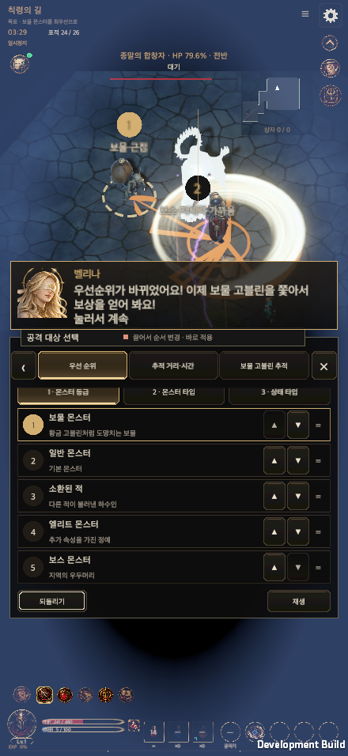
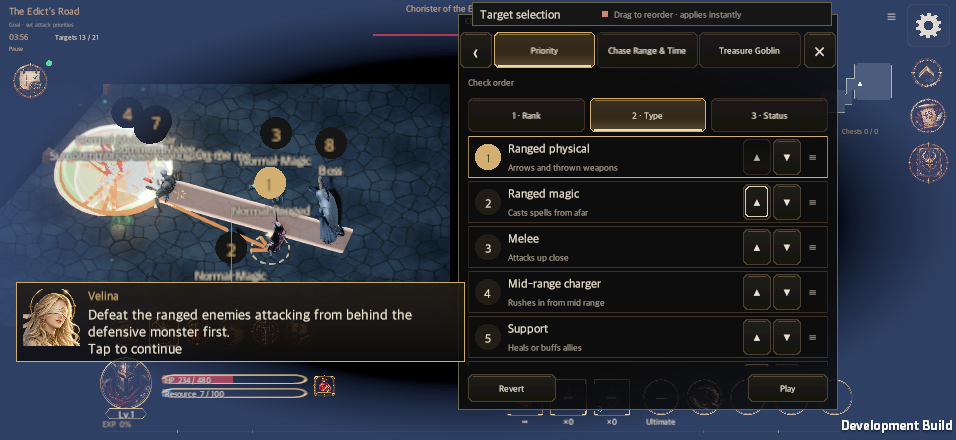

# Guide tutorial segment 3 integration

Updated: 2026-10-12

[한국어](Guide_Tutorial_Segment3_Plan_20261012.md). Implementation of the supplied plan, connected after [segment 2](Guide_Tutorial_Segment2_Plan_20261012.en.md) in the same PR. The original plan is retained as original-segment3-plan.md in the task validation directory.

## Flow

The gallery leads into the existing RM12 plaza. A melee tank stands ahead of two casters, a physical archer and a ranged summoning boss. Below half hero HP, before death protection or the next potion tick, Velina opens the target lesson.

| Phase | Transition |
| --- | --- |
| Road3 (12), MixedFight (13) | See the plaza pack, attack the melee tank, pause below half HP |
| TargetTalk (14) | Save NORMAL→SUMMONED→ELITE→BOSS and the first two types RANGED→CASTER |
| TargetFight (15), BossFight (16) | Defeat non-boss plaza enemies and summons; lower boss HP below 80% |
| GoblinAppear (17), GoblinTalk (18) | Move right for 0.9 seconds, pause in view; reveal the card and save TREASURE first |
| GoblinChase (19), ReturnToBoss (20) | Defeat the goblin, leave rewards behind, start returning to the boss; the loot lesson (`LootTalk`) starts 2 seconds later (`GuideTutorial.LootLessonSeconds`, changed 2026-10-20, 3 s → 2 s on the 21st; it used to start 0.5-1.5 s after the kill, right beside the dropped items) |
| LootTalk (21) | Save PRIORITY_LOOT first and personally press the existing close button |
| Pickup (22), LootDoneTalk (23) | Collect every reward and choose to return to the boss |
| FinalBoss (24), Cleared (25) | Defeat the boss; original closing dialogue and graduation transaction |

The boss survives incidental area damage until the final fight and stops attacking and summoning during the treasure scene. Residual Whirlwind cannot erase the goblin entrance. The goblin uses normal flee direction and movement within the plaza, with 55 HP and speed 1. Tutorial escape is disabled to prevent a stalled lesson. Ordinary rift rules remain intact.

## Existing panels and saves

No target, action or position panel is added or redesigned. Existing move buttons and world rank previews carry the lessons. UiVisibility.EnsureVisible reveals a clipped target inside its existing list, shared by the existing edict window and guide lessons. The first-ranked card is revealed before explanations. Starting grade order is NORMAL,BOSS,ELITE,SUMMONED,TREASURE; type is melee first; categories are GRADE,TYPE,STATUS. Separate goblin preference is OFF and persistent pursuit is ON. Attack precedes gathering.

Only four target options, the treasure disclosure key and common.order are disclosed at their lessons through existing transactions. TaughtOptions permits edits to taught, disclosed options; Details and full edict access wait until graduation. Live run identity survives account adoption.

Treasure is hidden only while a mandatory tutorial lacks seen-treasure-grade. Saved movement and drag previews use MoveVisible(full,visible,...), preserving hidden positions. Its card fades and scales in with a brief gold border once, respecting reduced motion.

Grade and type closing explanations use the existing gate narration card, tapped one line at a time. The panel and monster rank labels stay visible. When the narration overlaps ranks, it uses the less obstructive space above the panel or near the lower screen, prioritizing rank one. Target lessons close automatically after the explanations; gathering requires a manual close. GuideTutorial.Last is 25; the existing restart-from-the-beginning policy is retained.

## Real rewards

Actual account payment uses existing owners. The goblin drops its existing gold multiplier and one generated rare item. Tutorial rarity is fixed at rare (2), with rare pickup at PRIORITY. Rewards scatter beside or behind the hero on reachable floor and remain there through the return scene.

Normal resource pickup and CommitRecommendedLoot award gold and gear after the lesson. Only the live guide run is authorized; ordinary training and replay cannot earn these rewards. Gear, claimed flag and receipt save together. Failure preserves the floor item and existing receipts prevent duplicate claims.

## Validation

One completed full Edit Mode run on the integrated candidate: **6,036 passed, zero failed, four existing ignored**, 3,962 seconds. Native captures then exposed clipped scroll controls and narration covering a world rank. The affected GuideTutorialTests/PrologueGateTests **20 cases**, **15 UI contract regressions** and UI refresh checks (15 bindings) passed. Combat, save, data and packages match the full-run inputs; the entire suite was not repeated.

The final macOS development player passed **10/10** cases: KO and EN at 440×956, 956×440, 1600×900, 1600×1000 and 2100×900, default text size. Each case validates 44 gated EventSystem presses (skill 4, opening 3, combat position 4, target 16, treasure 9, gathering 8), world ranks during explanations, the paused goblin inside the viewport, manual close, real gold/rare gear pickup, reopening the save and one graduation. The clipped treasure control is scrolled into view and narration avoids rank one. The initial smoke projection mistake and UI-failure evidence are retained in the task validation directory.

[Summary](GuideTutorialEvidence20261012/validation.json), [full XML](GuideTutorialEvidence20261012/full-editmode.xml), [affected regression XML](GuideTutorialEvidence20261012/scroll-regression.xml), [KO report](GuideTutorialEvidence20261012/ko-runtime.txt), [EN report](GuideTutorialEvidence20261012/en-runtime.txt).

Evidence is a Metal macOS development player with accelerated fixed combat ticks and synthetic EventSystem pointers. Ordinary-speed feel, human comprehension, physical mobile, WebGL and performance improvement are not established.
