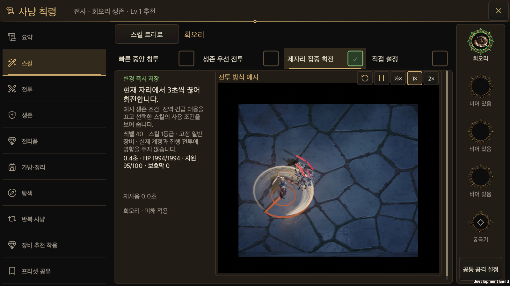
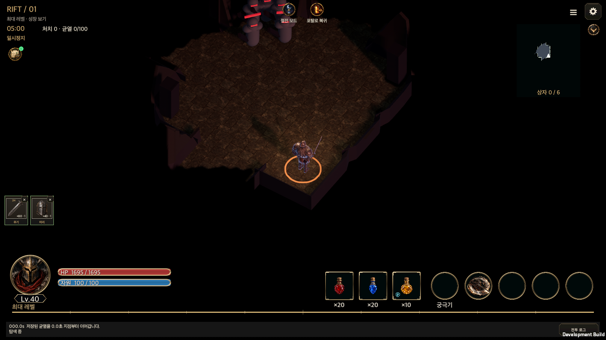

# Hunt Edict controls and Rift equipment recommendations

> **2026-10-28 A2 correction:** References to the large edict window, ≡ menu and their dedicated components or smokes are historical. Use the [current entry points](../../Assets/HELLSCRIPT/Runtime/Presentation/GameUI.HuntEdict.cs) and [replacement screens and source owners](Hunt_Edict_Window_Removal_20261028.en.md). Earlier captures and test counts describe the earlier implementation.

2026-10-13 card update [validation and captures](Rift_Gear_Offer_Cards_Plan_20261013.en.md#final-verification): 185 related Edit Mode tests, shared UI/refresh checks and native macOS screens/actions/save/portal/end checks across five sizes and both languages passed. Only failed coverage was rechecked. Full tests/public wiki await main merge; there is no physical-device/WebGL proof.

Updated: 2026-10-01 · [한국어](Hunt_Edict_Control_Refinement.md)

Outside taps close every Hunt Edict dialog and skill bubble exactly like X. The tap is consumed, without activating the screen behind it. Unapplied local selections and save confirmations are cancelled while the existing draft remains intact.

## Automatic equipment

- The master capsule toggle sits beside **Auto-equip recommended gear**. ON is green with the thumb on the right; OFF is gray with the thumb on the left.
- OFF dims and disables the common settings below the toggle and the per-position editors. Their values remain intact when ON is restored.
- Replaced equipment uses a compact anchored list for warehouse, salvage or sale. The warehouse-full shortcut appears only when warehouse storage is selected.
- Exclusions list ten physical positions with checkboxes, including both hands and both rings. Checked positions cannot be automatically filled, replaced or indirectly evicted by a two-handed or incompatible off-hand change. Manual equipment remains available.
- The old effect-preservation and equipment-score help controls are removed. Locks, sale/salvage protections and the score in shared item details remain.

`autoEquip.excludedSlots` is saved in global edict version 5. Versions 1–4 are validated before defaults are added. The deprecated preservation field remains known for canonical legacy save/share validation, but no longer controls automatic replacements.

## Equipment offers during Rift combat

The [approved 2026-10-13 card plan](Rift_Gear_Offer_Cards_Plan_20261013.en.md) is implemented. Acquisition checks rarity, range and every enabled threshold, then equip feasibility and the score rule. Higher post-swap score is the default; settings can offer all equippable gear. Only Normal, Magic, Rare, Legendary and Set exist. Auto-equipped gear and training/tutorial drops do not enter the manual queue.

Portrait cards are 92×150. Landscape scales the whole card and its text to 75% (69×114 with a 54-unit icon). The strip starts 12 from the left with a gap of 4 and wraps above `BattleHudTopOnPage`. Each card has an ellipsized name, icon with a magnifier, part, rounded score pill and centred 58×20 Equip button. There is no separate Details button. Signed score gain uses `0.#` precision and is omitted when no worn item is replaced.

One unhandled candidate per part appears in pickup order; all weapon/hand families share a group and both rings share a group. The magnifier and icon body open the same shared details. A worn item opens read-only comparison, worn left and candidate right, including portrait. An empty slot opens a single candidate. Other content retains the shared comparison's default portrait panes.

The gear opens Recommended Gear Settings in `ContentWindowView`: rarities, range and detailed conditions, recommendation rule, then popup duration. Only the detached draft changes until one per-hero account transaction saves it. New settings apply to later acquisitions; existing offers are not rejudged. The bag auto-salvage option catalog is reused with separate recommendation data. One range expands at a time, with common/additional conditions and numeric inputs. Manual close is the default; only timed mode enables the 1–60 s slider (10 s default).

Equip, close and expiry acknowledge the candidate and advance the queue. Popup time is paused and restarts on close. A failed expiry save preserves the queue, retries after the next interval and suppresses repeated identical error toasts. Existing acquisition/equipment/acknowledgement transactions persist `gearRecommended`, `gearHandled` and `gearOrder` atomically.

Cards show only on the battle page. Page changes and a portal town visit hide them without deleting the queue. Returning to the same run restores only that run's unhandled gear. `run.portal` and terminal runs cannot show or acknowledge cards. Death, clear or give-up removes them when `suspendedRun` is cleared. Reflow closure never acknowledges a candidate. Missing offer settings/ranges/options in older saves are normalized on read.

## Preset activation

The separate activation action is replaced by a single-choice box at the right of every tab. Exactly one active tab has a green check. Pressing a box opens and immediately saves that skill's policy. Pressing the tab body only browses its preview. Custom Settings follows the same rule. Unrelated pending allocation/global edits are not included in the policy save.

## Owners and verification

`HuntEdictWindow` owns shared modal and skill-bubble dismissal. Its Equipment and SkillPresets partials own the controls. `EquipmentRecommendation` owns exclusion decisions; `RiftGearRecommendations` and `GameStore` own the queue and persistence; `GameUI.GearRecommendations` owns combat tiles.

`RiftRecommendationWindow` uses the generated common content entry point and reuses `ContentWindowView`, `EquipmentSlotView`, `ItemDetailView`, `EquipmentComparisonView`, `UiTheme` and `UiFonts`. Display components do not directly mutate saves.

Final integrated validation is recorded below as one stage. Only default font size is tested; macOS synthetic pointers are separate from physical mobile verification.

### Validation on 2026-10-01

- [Evidence](HuntEdictControlsEvidence/validation.json): 261 related Edit Mode cases initially yielded 258 passes and three failures. Only the three failed cases were repaired and rerun; all 261 unique cases now pass. Shared UI ownership and its 11 validator tests also pass.
- The macOS development Player used actual EventSystem raycasts and pointer event dispatch. ON/OFF, the anchored list, per-tab selection, preview/save isolation and shared detail actions were checked at 440×956, 956×440, 1600×900, 1600×1000 and 2100×900 in Korean and English.
- After correcting the tile/HUD overlap, only the affected gear layout and queue coverage was rerun. All ten combinations retain the tiles above the HUD and inside the safe area with the journal expanded or collapsed. A fresh native process also confirmed saved exclusions, active preset, acknowledged items and the next pending offer.
- The existing full Edit Mode job completed 4,960 cases and was reused. Its 25 returned failures match the known ActionContinuity baseline; the failure list was capped and final pass/fail/skip totals were unavailable. This is not an overall pass, and the full suite was not rerun.
- Validation used an isolated save. No text-size matrix was run. Physical mobile devices remain untested.

