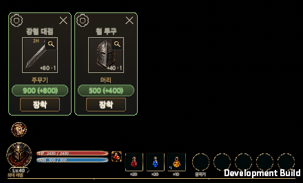
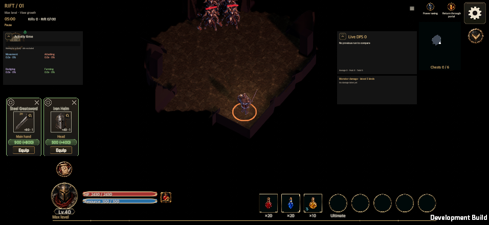
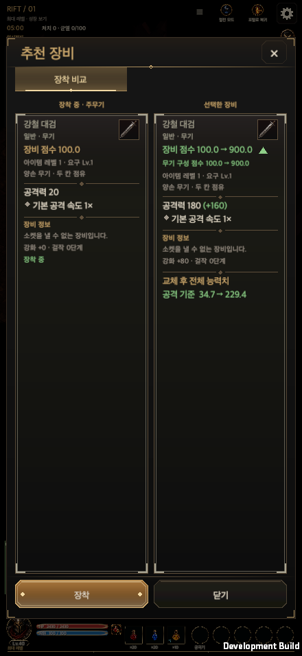
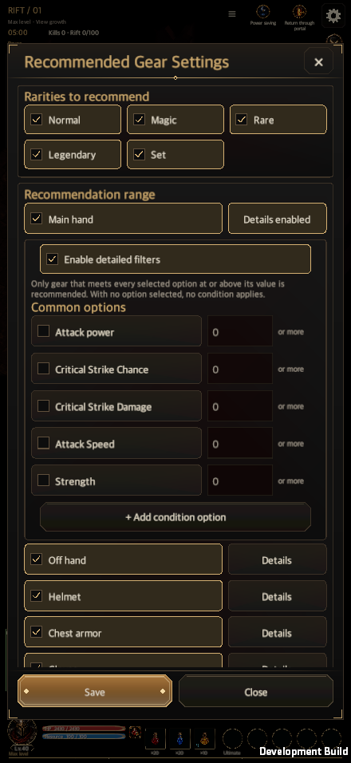

# 균열 장비 추천 카드 구현 계획

갱신일: 2026-10-13

[English](Rift_Gear_Offer_Cards_Plan_20261013.en.md)

대상: Codex 구현 작업. 기준은 승인된 시안 「균열 장비 추천 UI」(Claude 아티팩트 `https://claude.ai/artifact/1fVkuNDqhdWyHN7ZFmFMmp`, 비공개)입니다. 접근할 수 없으면 아래 치수·문구 표가 시안의 정본입니다. 시안은 HTML이므로 색·그라데이션은 기존 `UiTheme`·`UiButton`·`StorageSurface`·`EquipmentGradePalette`로 옮기고 새 색 리터럴은 추가하지 않습니다(`tools/check_ui_contract.py`의 색 리터럴 검사).

## 0. 시안 구성

아티팩트에는 16장이 있다. 화면 종류 4장 × (세로 440×956 한국어 / 세로 English / 가로 956×440 한국어 / 가로 English).

| 화면 | 보드 |
| --- | --- |
| 1 전투 중 추천 카드 | `Main`, `MainEn`, `MainLand`, `MainLandEn` |
| 2 상세(착용 중 장비 없음) | `Detail`, `DetailEn`, `DetailLand`, `DetailLandEn` |
| 3 상세(착용품과 비교) | `Compare`, `CompareEn`, `CompareLand`, `CompareLandEn` |
| 4 추천 장비 설정 | `Settings`, `SettingsEn`, `SettingsLand`, `SettingsLandEn` |

영어 보드의 문구는 게임 문구 표(`en.txt`)의 영어를 따랐고, 새 문구는 §4.4의 표가 정본이다. 가로 보드는 세로 보드를 옮긴 것이라 배치가 어색한 곳이 있으면 시안을 수정한 뒤 구현한다.

## 1. 현재 상태와 이번 작업의 범위

브랜치 `claude/rift-gear-offer-actions`(커밋 `c48c24d5`, 푸시됨, 미병합)에 시안 이전 단계의 구현이 있습니다. 이 브랜치에서 이어서 작업합니다.

| 영역 | 이미 있음(c48c24d5) | 이번에 할 일 |
| --- | --- | --- |
| 카드 | 이름·아이콘·부위·`점수 (+차이)`·장착/상세 버튼·톱니바퀴·× (폭 112) | **상세 버튼 제거, 아이콘 오른쪽 위 돋보기 추가, 장착 버튼 가운데·축소, 카드 폭 92, 시안 치수·모양 적용** |
| 상세 | 카드 상세 버튼 → `RiftRecommendationWindow`(`compareFirst`) | 돋보기가 같은 창을 연다. 착용품이 교체되면 비교 화면으로 연다 |
| 설정 | `RiftGearSettingsWindow` 4개 항목, 저장 | 시안과 문구·순서·배치를 맞추고 아래 보강 항목 적용 |
| 규칙 | 설정 판정, 획득순 대기열, 타이머 | 수명주기(마을·종료·재진입)를 테스트로 고정 |

## 2. 확정된 결정

1. 카드는 **전투 화면에서만** 보인다. 전투 화면을 벗어나면 숨긴다.
2. 같은 전투(진행 중 균열)에 다시 들어가면 그 전투에서 얻은 장비 중 **조건에 맞고 아직 장착·닫기를 하지 않은 것만** 다시 보인다.
3. 전투가 끝나면(사망·클리어·포기 등 `suspendedRun`이 사라지는 모든 경우) 카드 전부 사라진다.
4. **포탈로 마을에 가 있는 동안은 카드를 보이지 않는다.** 복귀하면 다시 보인다. 전투가 끝난 것이 아니므로 삭제하지 않는다.
5. 추천 대상 판정은 **획득 시점**에 한 번 한다(설정은 저장 이후 새로 얻은 장비부터 적용). 이미 대기 중인 카드는 설정을 바꿔도 유지한다.
6. 등급은 일반·마법·희귀·전설·세트 5개다. **고유 등급은 게임에 없으므로 만들지 않는다**(`Storage.Grade` 0~4와 같은 순서, 근거: `Docs/Design/Equipment_Comparison_Rules.md`).
7. 대기열은 **획득순**, 부위당 카드 1장. 같은 부위 다음 장비는 앞 카드를 처리(장착·닫기·시간 만료)한 뒤 나온다.
8. 시간 만료는 닫기(×)와 같은 처리(확인 완료로 저장)다.

## 3. 열린 항목(기본값으로 진행하고 보고에 적는다)

| 항목 | 기본값 |
| --- | --- |
| 아이콘 본체를 눌렀을 때 | 돋보기와 같이 상세를 연다(터치 면적 확보). 돋보기는 눈에 보이는 안내 |
| 설정 창이 열려 있는 동안 타이머 | 멈추고 닫으면 처음부터 다시 센다(구현됨) |
| 카드 남은 시간 표시 | 시안에 없으므로 만들지 않는다 |

## 4. 화면 명세

### 4.1 추천 카드 (시안 1번, 기준 폭 440)

카드 묶음은 화면 왼쪽 12, 카드 간격 4, 하단 HUD 바로 위(`BattleHudTopOnPage`)에 둔다. 한 줄에 들어가지 않으면 여러 줄. 모든 값은 카드 왼쪽 위 기준 px다.

| 요소 | 위치(x, y) | 크기 | 비고 |
| --- | --- | --- | --- |
| 카드 | — | 92×150 (가로 화면은 아이콘 54 기준으로 `슬롯+98`) | 테두리 1, 초록 계열(`SuccessHex`) |
| 톱니바퀴 | (0, 0) | 24×24 | `StorageGlyph "gear"`, 모든 카드에 동일, 같은 설정 창을 연다 |
| × | 오른쪽 위 | 24×24 | 확인 완료로 닫기 |
| 아이템 이름 | (3, 20) | 폭 86×14, 10pt 굵게 | 등급 색, 한 줄 줄임표 |
| 아이콘 | ((92−슬롯)/2, 36) | 슬롯(52/54) | 기존 `EquipmentSlotView` |
| 돋보기 | 아이콘 오른쪽 위 안쪽 (x+33, y+1) | 18×18 | 이름 `rift-gear-inspect-{id}`, 상세 창 열기 |
| 부위 | (2, 91) | 폭 88×13, 9pt | 금색 |
| 점수 알약 | (5, 105) | 폭 82×17, 10pt 굵게, 둥근 모서리 | `500 (+400)`. 차이는 착용품이 교체될 때만, 음수는 `DangerHex` |
| 장착 | **가운데** ((90−58)/2=16, 124) | **58×20**, 11pt | 기본 금색 버튼. 아래 여백 약 4, 글로우는 카드 밖으로 번지지 않게 |

상세 버튼은 없다. 점수는 `0.#` 형식(예: `149.6 (+28.6)`). 길어서 잘리면 안 되며 영어에서도 확인한다.

**가로 화면(`root.width > root.height`, 956×440·1600×900 등)에서는 카드 전체를 세로의 75%로 줄인다.** 위 표의 위치·크기·글자 크기에 모두 0.75를 곱한 형태(카드 약 69×112, 아이콘 슬롯도 0.75배)이고, 묶음의 왼쪽 시작 12·카드 간격은 그대로, 줄어든 높이로 HUD 바로 위(약 8 위)에 맞춘다. 시안은 `transform: scale(.75)`로 표현했다. 줄어든 글자가 읽히는지는 956×440에서 한국어·영어로 확인하고, 읽기 어려우면 비율을 임의로 바꾸지 말고 보고한다(80~85% 검토).

가로 화면의 나머지: 하단 HUD는 한 줄(HP 막대 왼쪽, 슬롯 오른쪽)이고 카드는 그 위 왼쪽에 놓인다.

### 4.2 상세 창 (시안 2·3번)

`RiftRecommendationWindow`를 그대로 쓴다(공통 `ItemDetailView`·`EquipmentComparisonView`). 돋보기는 `compareFirst=true`로 열어 착용품이 교체되면 비교 화면(착용 중 왼쪽·추천 후보 오른쪽, 후보에 `점수 A → B`, 반지·무기는 장착 칸 선택), 착용품이 없으면 후보 한 개만 보인다. 하단은 `장착`·`닫기`. 닫기는 확인 완료 처리(기존 동작), 장착 성공 시 창이 닫힌다.

### 4.3 추천 장비 설정 창 (시안 4번)

공통 `ContentWindowView`(최대 560×780) 안에 아래 순서. 가로 화면에서는 가운데 560×424 창이고 본문만 스크롤하며 `저장`·`닫기`(상세·비교 창은 `장착`·`닫기`)는 아래에 고정한다(시안은 잘린 채 표시). 초안 편집 후 `저장`(한 번의 거래)·`닫기`. 문구는 문구 표 키로 한국어·영어를 모두 채운다.

1. **추천 표시 등급** — 3열 격자 체크 토글: 일반·마법·희귀·전설·세트.
2. **추천 범위** — 주무기·보조무기·헬멧·상의·장갑·신발·벨트·목걸이·반지, 행마다 켜기 체크 + `세부 설정`(켜져 있으면 `세부 설정 사용 중`).
   - 펼침 패널: `세부 설정 사용` 체크, 안내문(선택한 옵션을 **모두** 기준값 이상으로 만족하는 장비만 추천, 선택이 없으면 조건 없음), `대표 옵션` 행(체크 + 이름 + 숫자 입력 + `이상`), 켠 `추가 옵션`, `＋ 조건 옵션 추가`(목록은 해당 부위에서 가능한 나머지 옵션). 펼침은 한 번에 한 부위. 표시·동작은 가방 자동 분해 설정(`EquipmentShopWindow.Settings`)의 세부 설정과 같고, 데이터는 별도다.
   - 목록 아래 안내문: 조건에 맞지 않거나 꺼 둔 장비는 추천하지 않으며 설정은 저장 이후 새로 획득한 장비부터 적용.
3. **추천 여부** — 라디오: `착용 가능한 모든 장비` / `현재 착용중인 장비보다 점수가 높은 장비`(기본).
4. **팝업 시간** — 라디오: `취소 버튼을 누를 때까지`(기본) / `지정 시간 후 닫힘`. 후자일 때만 슬라이더(1~60초, 기본 10초, 값 `10초` 표시)와 캡션 `1초 ~ 1분 (지정 시간 선택 시에만 사용)`. 아래에 만료·순서 안내문.

### 4.4 영어 문구(새 항목)

| 한국어 | English |
| --- | --- |
| 추천 장비 설정 | Recommended Gear Settings |
| 추천 표시 등급 / 추천 범위 / 추천 여부 / 팝업 시간 | Rarities to recommend / Recommendation range / Recommendation rule / Popup duration |
| 착용 가능한 모든 장비 | All equippable gear |
| 현재 착용중인 장비보다 점수가 높은 장비 | Gear with a higher score than what is worn |
| 취소 버튼을 누를 때까지 / 지정 시간 후 닫힘 | Until I press cancel / Close after a set time |
| ＋ 조건 옵션 추가 | + Add condition option |
| 1초 ~ 1분 (지정 시간 선택 시에만 사용) | 1 s – 1 min (used only with a set time) |
| 상의 | Chest armor |

긴 안내문 3개의 영어는 `Resources/Localization/en.txt`에 이미 있는 문구가 정본이다.

시안과 현재 구현의 차이로 확인할 것: 슬라이더 캡션, 라디오 문구 `현재 착용중인…`(띄어쓰기 시안 기준), 5개 등급, 패널 간격.

## 5. 규칙과 데이터

- 저장: `HeroSave.riftGearOffer`(`RiftGearOfferSettings`: `gradeMask` 31, `rangeMask` 511, `allWearable`, `timed`, `seconds` 1~60, 부위별 `RiftGearRange{id, details, thresholds}`). 캐릭터별, 계정 저장. 언어·화면 방향처럼 기기 저장이 아니다.
- 판정: `RiftGearRecommendations.CanOffer` → `RiftGearOfferSettings.Accepts`(등급·범위·필수 옵션) 뒤에 추천 규칙(`allWearable` 이면 유효한 장착 계획만, 아니면 교체 후 점수 상승).
- 대기열: `DropState.gearOrder`(획득 시 `max+1`) 순, 부위당 1장. `gearHandled` 저장은 기존 `DismissRiftGear`.
- 타이머: `GameUI.GearRecommendations.ExpireGearRecommendation`. 표시 중인 카드만 센다. 만료 시 닫기와 같은 거래. 저장 실패 시 다음 주기에 재시도(토스트 반복 주의).
- 새 `HeroSave` 필드는 `GameStore.Transact`의 영웅별 복사 목록에 반드시 추가한다(`target.riftGearOffer=source.riftGearOffer`). 빠뜨리면 저장한 설정이 메모리에서 사라진다. 이미 반영됨, 같은 종류의 새 필드를 만들면 다시 확인.

## 6. 구현 순서

1. **카드 재배치** — `GameUI.GearRecommendations.cs`: 폭 92·높이(가로 화면은 전체 0.75배), 상세 버튼 제거, 돋보기(이름 `rift-gear-inspect-{id}`), 장착 중앙·58×20, × 24, 톱니바퀴 24, 점수 알약. 상수는 한곳에 둔다.
2. **돋보기/아이콘 동작** — 둘 다 `OpenGearRecommendation(id, compareFirst: true)`. 기존 스모크가 쓰는 `rift-gear-compare` 토글 가정을 맞춘다(비교로 열리므로 토글하지 않음).
3. **설정 창 정리** — `RiftGearSettingsWindow.cs`를 4.3과 대조해 문구·순서·캡션·간격 보정. 영어는 `Resources/Localization/en.txt`.
4. **수명주기 고정** — 테스트·스모크로 §2의 1~4를 증명(아래).
5. **문서** — `Docs/Implementation/Hunt_Edict_Control_Refinement.md`의 균열 추천 절과 이 계획의 한국어·영어를 갱신. 위키 원본이 바뀌면 `AgentRules/Wiki_Publish.md`를 따른다.

## 7. 검증

작업 중에는 관련 검사만, 전체 Edit Mode·macOS 런타임 스모크는 마지막 변경과 `main` 통합 뒤 한 번만(전역 규칙).

- Edit Mode(`Hellscript.Tests.RecommendedEquipmentTests` 외 관련): 등급·범위·필수 옵션·추천 규칙 필터, 설정 저장·재로드(**라이브 영웅에도 반영**), 획득순 대기열, 시간 만료 뒤 다음 카드, 전투 종료 시 `Visible`이 비어 있음, 마을(포탈) 중에는 카드 생성·표시 없음(`run.portal`, `Page != "battle"`), 재진입 시 미처리 카드만 복원.
- 스모크: `-hellscriptEdictControlsSmoke -hellscriptEdictGearSmoke -hellscriptSavePath <빈 폴더> -hellscriptEvidence <빈 폴더>`(인자는 배열로 전달, 격리 저장 경로 필수). 세로 440×956·가로 956×440·1600×900·1600×1000·2100×900, 한국어·영어에서 카드가 HUD 위·안전 영역 안(가로는 0.75배 크기이며 글자가 읽힐 것), 카드 안 컨트롤(장착·돋보기·톱니·점수)이 카드 안에 있고 글자가 잘리지 않을 것, 돋보기→상세(비교), 장착 버튼, 설정 열기·저장·시간 만료, 마을 이동 중 숨김과 복귀 후 재표시.
- `python3 tools/check_ui_contract.py --verify`.
- 보고에는 확인한 것과 하지 않은 것을 구분한다(실기기·터치 미검증, macOS 결과를 실기기로 쓰지 않음).

## 8. 함정

- 화면 크기 변경은 전투 페이지를 재구축하고 팝업을 확인 처리 없이 닫는다. 같은 크기에서 언어만 바꾸면 상세창을 다시 그려 유지할 수 있다. 검증은 다음 상세를 열기 전에 페이지를 명시적으로 재구축한다. 페이지 재구축 때 미저장 설정 편집본이 사라지는 것은 승인된 한계다.
- `JsonUtility`는 누락된 리스트를 `[]`로 읽는다. 읽을 때 `Normalize()`로 부위·옵션을 채우고 길이를 믿지 않는다.
- 스모크 기본 진입(`-hellscriptEdictControlsSmoke`만)은 설정창 단계에서 이 작업과 무관하게 실패한다. 장비 추천만 돌리려면 `-hellscriptEdictGearSmoke`를 함께 준다.
- 제거한 글자 크기 조정·50~150% 검사는 다시 추가하지 않는다.
- 빌드·임시 산출물은 `AgentRules/Artifact_Cleanup.md`에 따라 정리하고 종료 시 상태를 기록한다.

## 9. 구현 기록 · 2026-10-13

- 내장 브라우저에서 16개 보드의 구조·문구와 카드·설정 확대 화면을 확인했다. 기존 `c48c24d5` 구현과 기획 커밋을 최신 `main`(`a5596519`)에 합친 격리 작업 폴더에서 이어서 구현했다. 원래 작업 폴더의 다른 튜토리얼 초안 두 개는 보존했다.
- 카드 치수·75% 가로 축소·돋보기·아이콘 본문·가운데 장착·점수 명판·이름 말줄임, 설정 순서·세부 패널·문구·시간 안내를 공통 부품으로 옮겼다. 돋보기는 바로 비교로 열고, 세로 나란히 비교는 `EquipmentComparisonView`의 콘텐츠별 선택값으로 제공한다. 다른 화면의 기본 비교 탭은 바꾸지 않는다.
- 획득 순서, 획득 시 1회 판정, 포탈·종료 경계, 저장 후 살아 있는 영웅과 다시 읽은 영웅의 동일 설정을 검사에 추가했다. 누락된 설정 목록은 읽을 때 정규화하고 만료 저장 실패의 반복 알림을 막는다.
- 기본값: 아이콘 전체도 상세를 연다. 팝업 중 시간은 멈추고 닫으면 0부터 다시 시작한다. 남은 시간 표시를 추가하지 않는다.
- 최종 관련 검사와 macOS 장비 전용 검증 결과는 이 절에 모은다. 전체 Edit Mode·전체 런타임 묶음·공개 위키는 `main` 병합 단계의 한 번 검증·게시 규칙을 따른다.
- 산출물 소유·크기·보존 상태: `Builds/RiftGearOfferCards20261013/artifact-lifecycle.json`. 신규 래스터·새 의존성·프로젝트 전체 사본은 만들지 않았다.

### 최종 검증

- [검증 기록](RiftGearOfferCardsEvidence20261013/validation.json): 관련 Edit Mode 185개 통과, 실패·건너뜀 0. 공통 UI 계약과 검사기 회귀 15개, UI 갱신 검사 통과. 이후 바꾸지 않은 코어·공통 표시·검사 결과는 재사용했다.
- macOS 다섯 크기 × 한국어·영어에서 화면 픽셀 치수·75% 축소·안전 영역·컨트롤·문구·고정 행동 영역을 확인했다. 카드는 기존 HUD 픽셀 캔버스를 재사용하고 돌출된 사냥 칙령 버튼의 입력 영역 위에 놓는다. 표시 상태가 같으면 활성화를 반복 전환하지 않는다.
- 돋보기/아이콘 → 비교, 상세/빠른 장착·닫기, 감소 점수의 붉은 표시, 설정 편집본·추가 조건·저장·취소·살아 있는 영웅/다시 읽은 영웅 동일 설정, 팝업 중 실제 타이머 정지/재시작·만료, 빈 부위 상세 10개 조합, 가방 이동·마을 포탈·복귀·전투 종료·종료 후 다시 읽기를 확인했다.
- 최초 장비 흐름 후 실패/변경 범위만 네 번 재검사했다. 실제 입력을 가로챈 HUD 버튼, 화면 픽셀/글자 래스터 배율, 같은 크기 언어 전환에서 상세창이 유지되는 검사 가정, 팝업 중 갱신 보류와 타이머, 가방 페이지에서 갱신 보류로 카드가 남는 경로를 수정했다. 변경하지 않은 설정·비교창 결과는 재사용했다.
- 산출물 기록 이후 약 71분, 검증 도구 실행 약 6분, 승인·연결 대기 0. 관련 Edit Mode 1회·검사기 회귀 1회·macOS 빌드 5회·장비 흐름 1회와 영향 범위 재검사 4회.
- 전체 Edit Mode/전체 런타임 묶음과 위키 생성·공개 게시는 `main` 병합 전이라 수행하지 않았다. WebGL·모바일 실기기·터치·노치는 검증하지 않았다. 가로 75% 문구는 macOS 956×440 캡처에서 확인했고 비율을 임의로 높이지 않았다.

