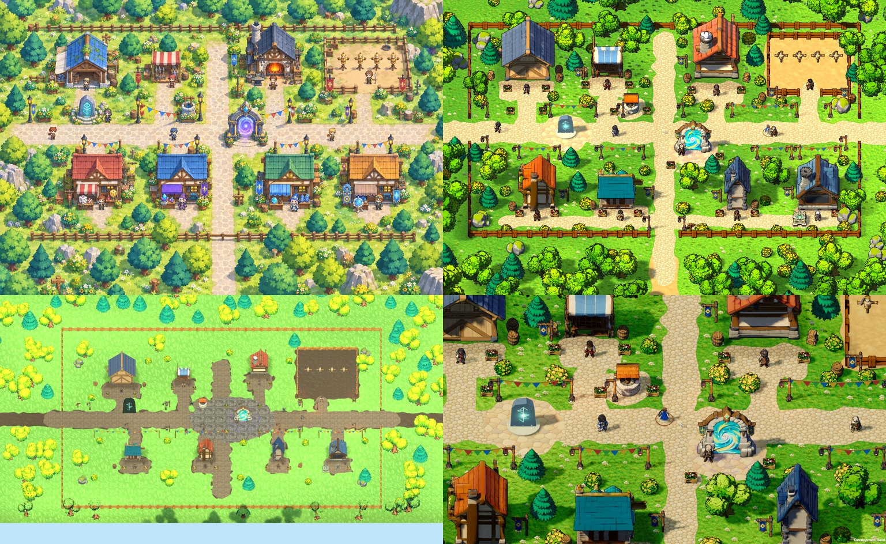
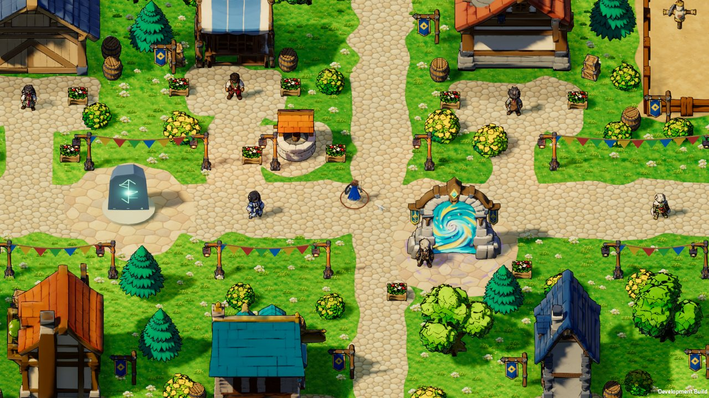
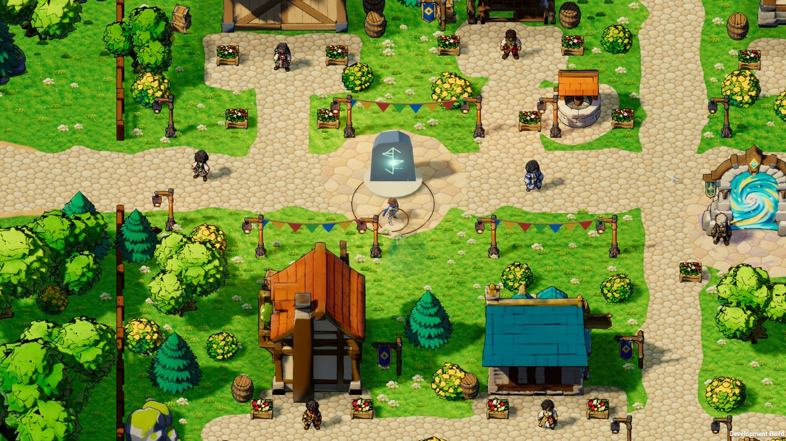
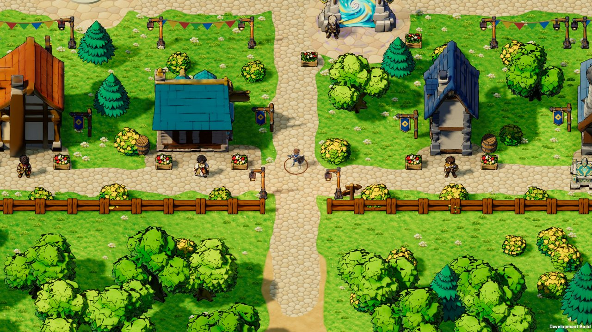
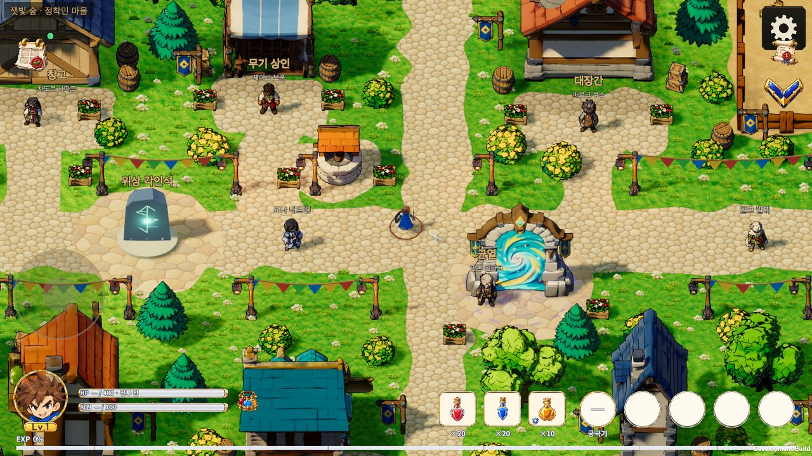
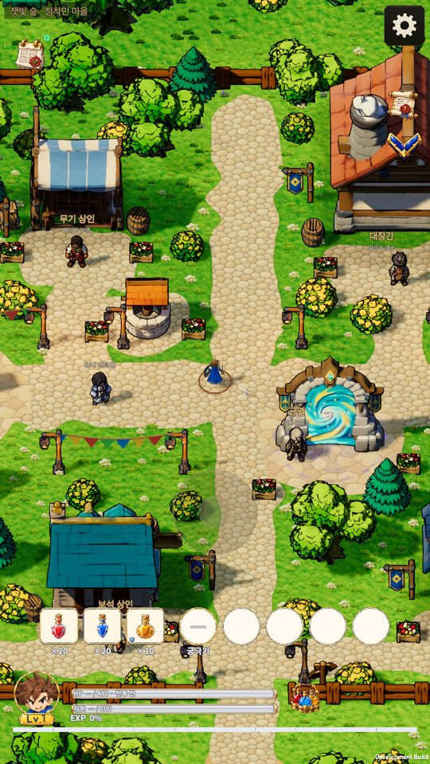

# Casual town rebuild · 2026-10-17

[한국어](Town_Casual_Rebuild_20261017.md)

At the user's request ("forget the old town layout and design a cute casual town like the concept; change the camera, lighting and shaders if needed") the town was rebuilt from the approved concept [town_overview_gameview_v01](../Art/CasualConcept/2026-10-13/Town/town_overview_gameview_v01.png). The ten services, NPCs, dialogue, trading and save keys are unchanged; positions, sizes, dressing, ground, lighting and shaders changed.

Top left the concept, top right the new town in the same 1536×1024 framing, bottom left the previous town, bottom right the real play camera.

## Layout

The concept was measured at about 18 px/m and turned into metres. The fence encloses 75×53 m (was 118×87 m), the walkable area is 70×48 m and the main street takes 12.7 s to cross.

| Place | Facilities |
| --- | --- |
| North row (west to east) | warehouse, weapon stall, well, forge, training yard (sand, fenced on three sides, front entrance) |
| Middle of the west main street | aspect stone on a round flagstone court (the user's placement) |
| South edge of the crossroads | rift gateway on a round flagstone court |
| South row (west to east) | gamble, gem, rune and rune-workshop houses with forecourts and a shop lane |
| Gates | west and east (main street), south (spine) |

The existing Hunyuan building models are shown at scale 1.0-1.35 and each collision rectangle is the model footprint times that scale. The south row's depth and height keep its roofs below the main street on screen. Twelve trees inside the town and the well are `TownLayout.Obstacles`, so routes go around them, and the trees fade like houses when the hero stands behind them.

## Art and shaders

- Ground: Codex painted meadow, cobblestone, flagstone and sand tiles in the concept's style ([sources and prompt](../Art/CasualConcept/2026-10-17/TownGround/PROMPT_town_ground.md)). `tools/make_town_ground.py` fixes the seams, writes 512 px maps and normals and reproduces the runtime files byte for byte. The ground shader adds meadow colour patches and a soft shade along path edges; the mud shoulders are gone.
- Grass tufts and wildflowers: two Codex sprites in one atlas, about four thousand of them in a single mesh (`TownScatter.shader`, wind sway, receives shadows only).
- Toon shader `TownToon.shader`, for `Town/` models only: one shadow step tinted cool blue-violet, extra sun on upward faces, a sky rim and a 1.4 px brown inverted-hull outline. Rifts keep `RiftTerrain`.
- Lighting: the sun now comes from the screen's front left (yaw 40), so facades are lit and shadows fall to the right where the camera sees them. Cooler ambient, contrast +10, a warm filter. Town particles are pollen, petals and sparkles instead of grey dust.
- Seven tree and shrub tints, a darker brown fence and larger bunting strung between lantern posts.

## Verification

- Related Edit Mode: 13 classes, 206 tests passed (re-run after merging main). The full Edit Mode suite was not run, per the 2026-10-17 rule on main. Details in the [receipt](TownJuicyEvidence20261017/receipt.json).
- macOS development build (tree merged with main): the town look smoke (26 captures) and the town models smoke in landscape 1600×900 and portrait 900×1600 pass (every building and NPC is a model, all ten services reached, the stall fades behind the hero).
- Not verified: physical devices, Android/iOS/WebGL visuals and performance, draw calls, repeated English screens, the outline's mobile GPU cost. No performance improvement is claimed (one scatter mesh and an outline pass were added).

## 2026-10-17 merge validation / 병합 검증

Latest main f8b8e039 merged without conflicts. CI-equivalent UI contract (15), skill generators and Python tests (3 + 3 + 18) passed; generated tracked files unchanged. Existing town evidence (206 focused tests and macOS smokes) is reused because the town runtime/test inputs did not change; later main changes affect the guide/growth and rift monster rendering. No full Edit Mode or new player build ran. GitHub Actions jobs did not start due to account billing/spending restrictions.

최신 main을 충돌 없이 통합했고 CI와 동일한 로컬 검사를 통과했다. 마을 소스가 동일하여 기존 마을 검증 근거를 재사용한다. 위키 생성은 기존 문서 이력의 절대 경로 링크에서 중단되었다(`Nonportable local Markdown link: Docs/Implementation/Casual_UI_Skin_Rules_20261014.en.md`). 앞선 main에도 공개 원본 스냅샷 목록 변경으로 게시가 막힌 기록이 있다. 위키 검사·테스트·공개 배포는 완료하지 않았으며 부분 게시하지 않았다. / Wiki generation stopped on an existing nonportable absolute link in document history. Earlier main also records a changed public-original snapshot inventory. Wiki checks/tests and public delivery remain incomplete; no partial publication was made.

Small logs, generated history and materialized historical wiki inputs are retained in `Builds/Validation/TownMerge20261017/` and its lifecycle manifest, review 2026-10-24; exact permanent deletion is not authorized. / 검사 기록과 재생성 산출물은 보존하며 영구 삭제는 미승인이다.
