# 마을 3D 모델 적용 (훈위안 생성 모델 20종)

작성일: 2026-10-06 · [English](Town_Hunyuan_Models.en.md)

마을의 NPC 12명, 건물 3채, 균열 아치, 우물·가로등·훈련 허수아비·룬 제단을 훈위안(Tencent Hunyuan3D)이 생성한 모델 20종으로 바꿨다. 모델은 이 저장소의 월드 아트 규약(`Resources/World/<묶음>/<Id>.fbx` + `_A.png` + `_N.png` + 매니페스트)에 맞춰 `World/Town/`에 넣었다. 마을 장면은 모델이 있으면 모델을, 없으면 기존 도형을 그린다. NPC 이름·위치·서비스·대화와 저장 데이터는 바뀌지 않았다.

## 한눈에

| 항목 | 내용 |
|---|---|
| 모델 | 20종: NPC 12 · 건물 3 · 균열 아치 1 · 소품 4 |
| 삼각형 | 모델 합계 106,000 (NPC·건물·아치 6,000, 소품 2,500) |
| 저장소 증가 | 약 32 MiB (FBX 10.9 + PNG 21.0) |
| 출시 용량 추정 | 약 17.2 MiB (메시 7.7 + ASTC 텍스처 9.5, APK 압축 전). 계산값이며 빌드로 재지 않았다 |
| 검증 | Edit Mode, macOS 개발 빌드 런타임 스모크(가로 1600×900, 세로 900×1600) |
| 상태 | 개발용 후보. 라이선스 검토와 출시 아트 승인 전이다 |

## 적용 대상

| 마을 요소 | 모델 | 높이 | 삼각형 | 텍스처 |
|---|---|---:|---:|---:|
| 대장간 NPC 마르크 쿠스 | `Npc_MarkKus` | 2.50 m | 6,000 | 512 |
| 창고 NPC 차도르 사마프 | `Npc_ChadorSamaf` | 2.52 m | 6,000 | 512 |
| 무기 상인 제이크 보쿤 | `Npc_JakeBokun` | 2.52 m | 6,000 | 512 |
| 균열 담당 안톤 진다크 | `Npc_AntonJindark` | 2.47 m | 6,000 | 512 |
| 룬 마스터 인젤 미르 | `Npc_InjelMir` | 2.49 m | 6,000 | 512 |
| 갬블 상인 자크 체이 | `Npc_JacquesChei` | 2.50 m | 6,000 | 512 |
| 훈련 교관 터크 가르비 | `Npc_TurkGarbi` | 2.46 m | 6,000 | 512 |
| 보석 상인 구젤 판 | `Npc_GuzelPan` | 2.46 m | 6,000 | 512 |
| 룬 상인 미슈 카루 | `Npc_MishuKaru` | 2.48 m | 6,000 | 512 |
| 행인 표냐 내르뭰 | `Npc_PyonyaNermwen` | 2.47 m | 6,000 | 512 |
| 행인 쟝 죠린 | `Npc_JeanJorin` | 2.43 m | 6,000 | 512 |
| 행인 달크 알뷔 | `Npc_DarcAlvi` | 2.44 m | 6,000 | 512 |
| 대장간 건물 | `Building_Blacksmith` | 9.6 m | 6,000 | 1024 |
| 창고 건물 | `Building_Warehouse` | 9.6 m | 6,000 | 1024 |
| 장비 상점 가판대 | `Building_Merchant` | 5.6 m | 6,000 | 1024 |
| 균열 포탈 석조 아치 | `Portal_RiftGateway` | 8.0 m | 6,000 | 1024 |
| 룬 제단 (룬 마스터 옆) | `Prop_RuneAltar` | 2.7 m | 2,500 | 512 |
| 돌우물 | `Prop_StoneWell` | 4.0 m | 2,500 | 512 |
| 철제 가로등 (17곳에 재사용) | `Prop_TownLantern` | 4.0 m | 2,500 | 512 |
| 훈련용 허수아비 (4곳에 재사용) | `Prop_TrainingDummy` | 3.0 m | 2,500 | 512 |

갬블·보석·룬 상점과 룬 공방 건물, 위상 각인석, 나무·울타리·바닥은 모델이 없어 기존 표현을 그대로 둔다. 가로등과 허수아비는 한 모델을 여러 곳에 놓으므로 장면 전체의 삼각형 합계는 약 15.4만이다(중복 포함, 시야 밖 제거 전).

## 원본에서 게임 등급까지

원본은 훈위안 웹(HY3D-V3.1, 텍스트→3D PBR)이 2026-10-06에 만든 GLB다. 한 메시에 5만 면, 4096×4096 PNG 3장(색·금속/거칠기·법선)이고 파일당 25~42 MiB여서 그대로는 쓸 수 없었다.

1. **경량화.** Blender 5.2를 명령줄로 실행한다. 정점을 용접하고, 원본 사본을 줄이고(붕괴 감소), 새 UV를 펼친 뒤, **원본에서** 색·ORM·접선 공간 법선을 새 텍스처로 굽는다. 면 수만 줄이면 얼굴·옷 주름의 음영이 사라지므로 굽기까지 해야 형태감이 남는다.
2. **등급.** 프로젝트 자산 예산(PLAN §4)에 맞춘다. NPC 6,000면·512 px, 건물·아치 6,000면·1024 px, 큰 소품 2,500면·512 px이다. 납품용 10,000면 등급과 별도로 같은 원본에서 다시 구웠다. 이미 줄인 결과를 다시 줄이지 않아 화질 손실이 작다.
3. **품질 검사.** 같은 카메라·조명으로 원본과 8방향(눈높이 4 + 게임 카메라 각도 약 49° 4)에서 렌더 비교했다. 20종 모두 덩어리 모양의 색·음영 결함이 없고 메시에 열린 변이 없다. 원본과의 유사도(SSIM, 8방향 평균)는 일반 0.78~0.98이며, 점수가 가장 낮은 모델(허수아비·돌우물·룬 제단·자크 체이·차도르 사마프)과 아치는 비교 시트를 눈으로 확인했다.
4. **합계.** 20종 644 MiB → 게임 등급 GLB 28.8 MiB, 삼각형 993,495 → 106,000.

경량화 결과 전체(모델별 수치, 비교 시트, 소요 시간)는 저장소 밖의 납품 폴더 `AssetDeliverables/Hunyuan/2026-10-06/optimized/`에 있다. 원본 GLB는 수정하지 않았다.

## 가져오기

- `tools/hunyuan_town_export.py`(Blender): 변환을 적용하고 높이 또는 배율에 맞추며, 앞면이 Unity에서 NPC는 +Z, 건물·소품은 −Z(카메라 쪽)가 되도록 돌린다. 발바닥 중앙을 원점에 놓고 FBX로 내보낸다. 이 도구가 만드는 모델은 한 메시이며 가져오기 도구가 한 정적 메시로 합친다.
- `tools/import_hunyuan_town.py`: 모델별 `<Id>.fbx`, `<Id>_A.png`(RGB 알베도 + 알파 = 매끄러움 = 1 − 거칠기), `<Id>_N.png`(법선)와 `manifest_town_hunyuan.json`을 만들고 Unity 메타를 쓴다. 매니페스트에는 모델별 삼각형·높이·풋프린트·앞면·경량화한 GLB의 SHA-256·예산 등급을 적는다. 상태는 `productionApproved: false`다.
- `tools/generate_world_art.py --check`는 새 리비전 `hellscript-hunyuan-town-v1`을 인정한다. 이 묶음에서 이름 규칙·2의 거듭제곱 텍스처·예산·메타 GUID·코드 참조를 검사한다(139개 자산, 문제 0).
- Android 텍스처 예산 `ResourceTextureBudget`에 `World/Town/`(최대 1024, ASTC 6×6) 행을 더했다. `WorldArtImporter`의 가져오기 상한도 이 폴더에서 1024다. 건물·아치만 1024 파일이고 나머지는 512 파일이라 큰 상한이 작은 파일을 키우지 않는다.
- 금속성은 쓰지 않는다. 월드 셰이더(`RiftTerrain`)의 `_Metallic`이 모델 전체에 하나뿐인 값이라 금속 마스크를 담을 곳이 없다. 발광 마스크도 없다. 가로등 불빛은 기존 점광원 이미터가 맡는다.

## 게임 코드

- `WorldView.TownModels.cs`: `TownNpcArt`·`TownBuildingArt`가 모델 이름을 정하고, `SpawnTownModel`이 `WorldArt`로 생성한다. 모델이 없으면 `null`을 돌려 호출한 쪽이 기존 도형을 그린다. 사람은 `CreateTownModelFigure`가 만들며, 기존 도형 인물의 규약(앞면이 로컬 −Z, 호출한 쪽이 카메라로 돌린다)을 지키도록 모델을 안쪽에서 180° 돌린다.
- `WorldView.Town.cs`: 담당 NPC·행인·건물·가로등·우물·허수아비·룬 제단·균열 아치를 모델로 만든다. 건물은 기존 `TownBuildingFade`(캐릭터가 건물 뒤에 서면 반투명)를 그대로 등록한다. 가로등 불빛 위치는 모델의 유리 높이(2.65 m, 알베도에서 실측 2.62 m)에 맞춘다. 가져온 모델은 CPU가 읽을 수 없는 메시여서 `BatchTownGeometry`가 읽을 수 있는 메시만 합친다.
- `TownWalk.cs`: 세 건물의 충돌 영역을 모델 풋프린트에 맞춘다(아래 표).
- `RuntimeTownModelsSmoke.cs`(개발 빌드 전용), `TownModelTests.cs`(Edit Mode)가 검증을 맡는다.

### 충돌 영역 변경

앞쪽 가장자리가 NPC 서는 자리와 맞도록 창고와 대장간은 유지하고 무기 상점은 새로 맞췄다. 이동 가능 영역 판정은 사각형으로만 하며(도형·모델에는 콜라이더가 없다) 이 사각형만 바꿨다.

| 시설 | 이전 (가로 × 세로, 마을 y 범위) | 이후 | 모델 풋프린트 |
|---|---|---|---|
| 창고 | 14 × 10, y 16~26 | 11.2 × 9.6, y 16~25.6 | 11.09 × 9.63 |
| 무기 상점 | 12 × 9, y 19.5~28.5 | 6.2 × 4.5, y 17.8~22.3 | 6.06 × 4.47 |
| 대장간 | 14 × 9, y 20.5~29.5 | 8.2 × 8.4, y 20.5~28.9 | 8.05 × 8.38 |

### 균열 아치와 포탈 효과

아치 모델이 기존 포탈 단상(받침 도형)을 대신한다. 금빛 고리·궤도 문양·불씨·막·점광원은 `Portal effect` 묶음으로 모아 아치 안쪽으로 줄여(배율 0.55) 커튼 면 바로 뒤에 둔다. 아치의 커튼이 연 틈은 폭 약 3 m, 높이 약 6 m이고(레이캐스트로 측정), 고리의 아래쪽 절반이 이 틈에서 가장 잘 보인다. 모델의 커튼 메시를 고치지는 않았다. 돌아오는 포탈(전투에서 귀환)은 모델을 쓰지 않는다.

## 용량

계산값이며 Unity 빌드로 재지 않았다. 메시는 가져오기 도구가 쓰는 정점 구성(정점당 52 B, 인덱스 2 B)으로, 텍스처는 ASTC 6×6과 밉맵을 가정했다.

| 항목 | 용량 |
|---|---:|
| 메시 (정점 142,986개, 삼각형 106,000) | 7.7 MiB |
| 텍스처 — NPC 12 | 3.6 MiB |
| 텍스처 — 건물 3 + 아치 | 4.7 MiB |
| 텍스처 — 소품 4 | 1.2 MiB |
| **합계 (APK 압축 전)** | **17.2 MiB** |

웹(WebGL) 빌드는 `ResourceTextureBudget`이 이 폴더의 텍스처를 ETC2 RGBA8(픽셀당 8비트)로 압축하므로 텍스처가 약 21.3 MiB, 메시를 더해 약 29.0 MiB가 된다(같은 방식의 계산값).

## 검증

- `python3 tools/generate_world_art.py --check`: 139개 자산, 문제 0. `python3 tools/test_world_art.py`: 26개 통과. [점검 기록](TownHunyuanEvidence/checks.txt)
- Unity 6000.6.0f1 Edit Mode: 새 `TownModelTests`는 NPC 12명 모두의 모델 존재와 높이(2.2~2.8 m), 세 건물의 충돌 영역과 모델 풋프린트 차이(0.5 m 이내), 모델마다 정적 메시 1개·바닥 y=0·중심 정렬·매니페스트와 같은 삼각형 수, 40개 PNG의 Android 오버라이드(ASTC 6×6, 최대 크기 ≥ 이미지 변)를 확인한다. 전체 결과는 아래 '전체 검사'에 있다.
- macOS 개발 빌드 런타임 스모크 `-hellscriptTownModelsSmoke`: 오프라인 QA 게스트로 입장해(`-hellscriptOfflineQa`, 별도 저장 경로) 모든 담당 NPC·행인·세 건물·균열 아치가 `World/Town` 모델(도형이 아닌 것)인지 메시 이름으로 확인하고, 서비스 10곳에 모두 도달했으며, 가판대가 캐릭터 뒤에서 흐려지는 동작을 확인했다. 우물·허수아비·가로등은 지정 위치로 이동해 화면으로 확인했다. 가로 1600×900과 세로 900×1600에서 모두 통과했다(종료 코드 0, `HELLSCRIPT_TOWN_MODELS_SMOKE_OK`). [결과 기록](TownHunyuanEvidence/smoke-result.txt)
- 기존 `Plaza`·`TownHud` 스모크는 이 변경과 무관하게 마을에 도달하지 못한다. 2026-09-26 전체 스모크 기준선(저장소 밖 `Artifacts/Validation/FinalMain20260926/compare.txt`)에서도 같은 위치에서 실패했다(`Entry did not arrive at spawn.`, `NullReferenceException`). 신규 계정이 튜토리얼부터 시작하기 때문이다. 튜토리얼·출석 창을 건너뛰는 설정을 임시 복제본에만 넣어 돌려 보니 `Plaza`는 상호작용 카드 여백 검사(`Interaction right inset drifted.`)에서, `TownHud`는 훈련장 창 구조 변경 뒤에도 `Page=="training"`을 기대하는 검사(`Named NPC opened the wrong service: Training`)에서 멈췄다. 두 곳 모두 이 변경이 건드리지 않은 UI·훈련장 코드다. 이 스모크들을 고치는 일은 이번 범위가 아니어서 저장소의 두 파일은 바꾸지 않았다.

스모크는 개발 빌드에서 이렇게 실행한다. 저장 폴더는 비어 있는 일회용 경로여야 하며, 인자는 배열로 넘겨야 한다(zsh는 문자열을 나누지 않는다).

```bash
ARGS=(-hellscriptTownModelsSmoke -hellscriptOfflineQa -hellscriptSavePath "$SAVE" -hellscriptScreenshots "$SHOTS" -screen-fullscreen 0 -screen-width 1600 -screen-height 900)
"<빌드>/HELLSCRIPT.app/Contents/MacOS/HELLSCRIPT" "${ARGS[@]}"
```

### 실행 화면

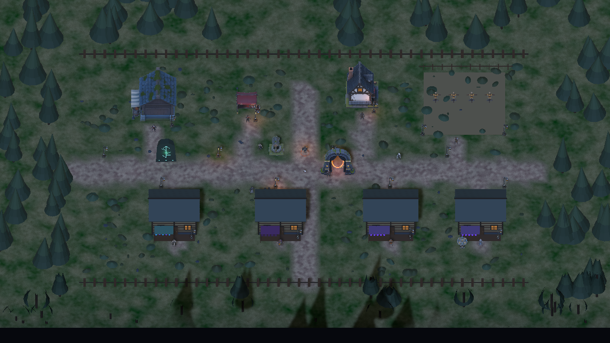

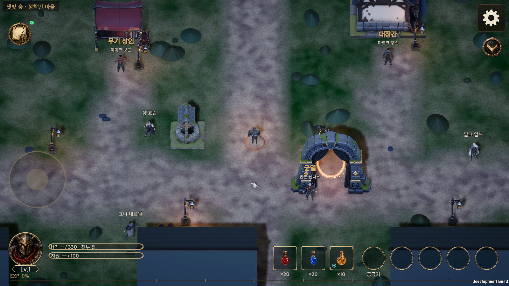

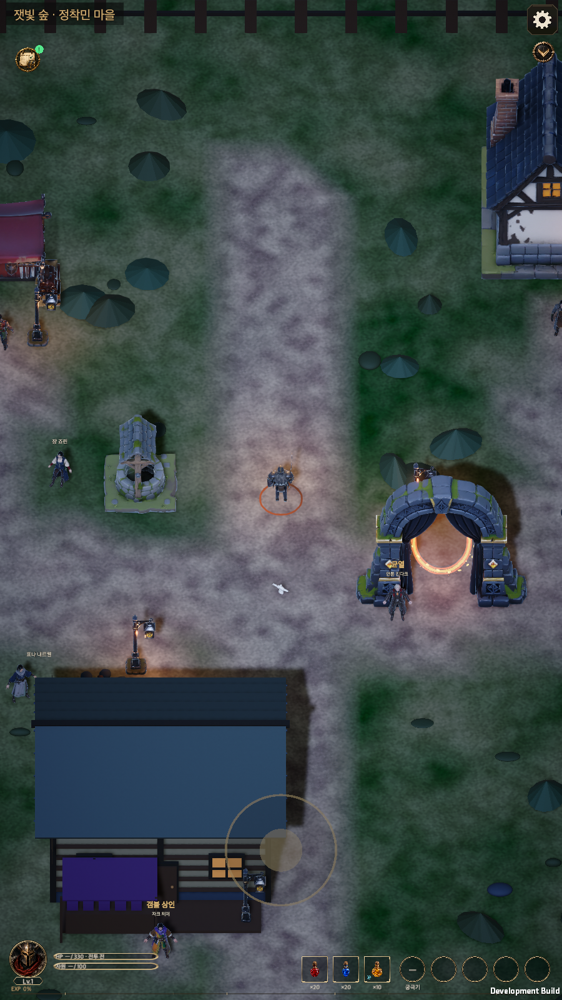

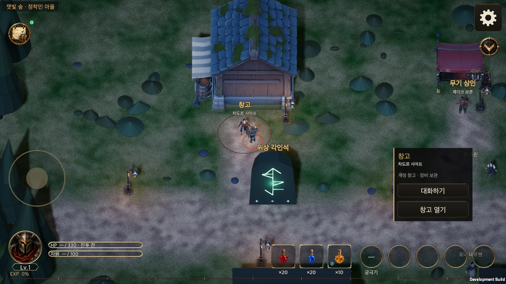

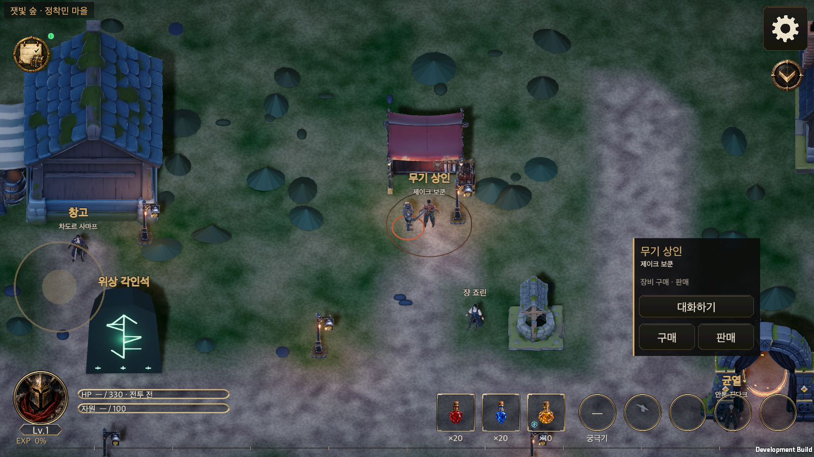

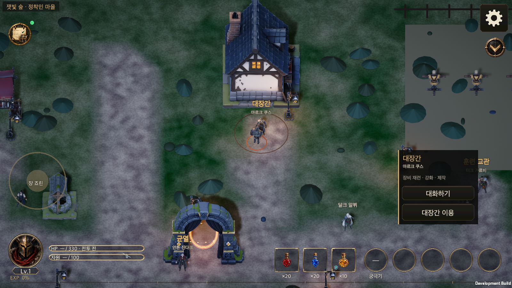

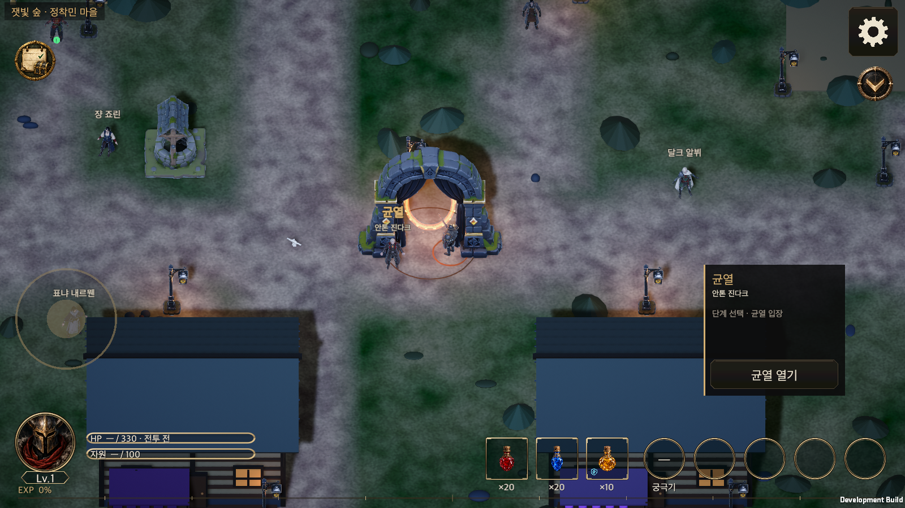

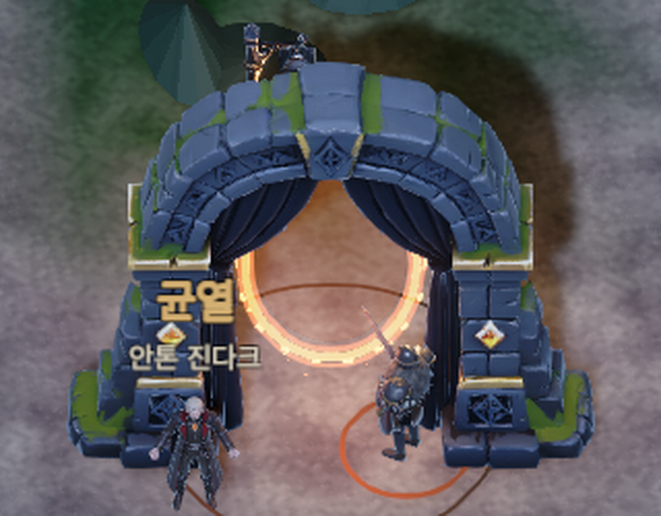

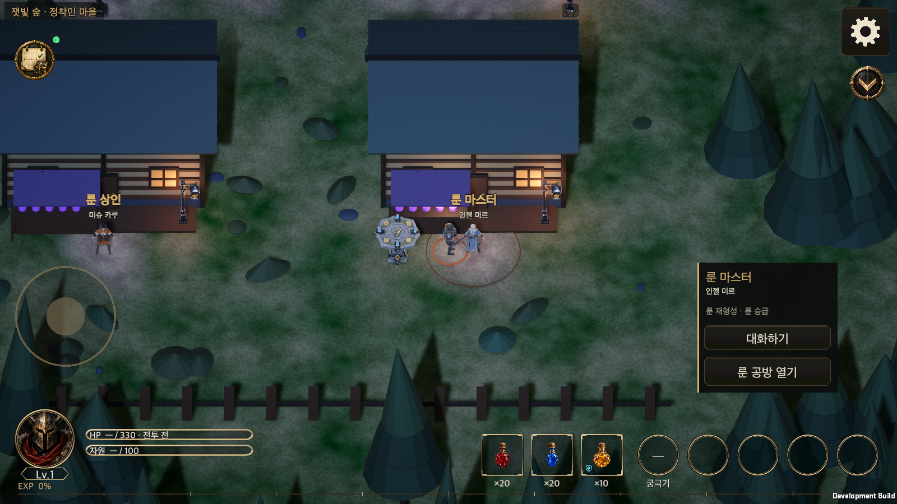

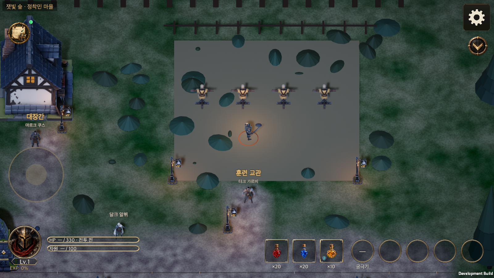

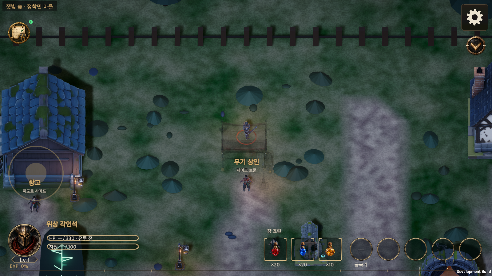

## 전체 검사

마지막 코드 변경(룬 제단 위치 조정) 뒤 Unity 6000.6.0f1 Edit Mode 전체를 한 번 실행했다. 기준은 `origin/main` d1d762fb 위의 커밋 c9460dd9이고 약 31분이 걸렸다. 프로젝트 복제본의 `Assets`는 이 브랜치와 같으며 문서·위키·서버·도구 폴더도 함께 복사했다. [결과 요약](TownHunyuanEvidence/editmode.json)을 보존한다.

| 항목 | 결과 |
|---|---|
| 전체 | 5,211개 중 5,210개 통과, 실패 0, 건너뜀 1 |
| 건너뛴 1개 | `ClassSkillPassiveMeasurement.MeasureEveryDesignBuild`: 환경 변수 `HELLSCRIPT_MEASURE_OUT`을 줄 때 따로 돌리는 측정 도구라 전체 실행에서는 건너뛴다 |
| `TownModelTests` | 6/6 |
| `TownWalkTests` | 20/20 (충돌 영역 변경 포함) |
| `WorldArtTests` | 39/39 |
| `LocalizationTests` · `StoredLocalizationTests` | 33/33 · 19/19 |

기존 런타임 스모크 묶음은 이번에 다시 돌리지 않았다. 새 마을 모델 스모크는 마지막 코드 변경 뒤 가로·세로로 통과했다(위). 마을을 지나는 기존 스모크는 2026-09-26 기준선에서 이미 입장 단계에서 실패하던 상태여서(`Plaza`·`TownHud`는 앞서 적은 대로) 이 변경에 대한 신호를 주지 못한다.

## 알려진 한계와 후속

- **확인하지 않은 것.** iOS·Android 실기기, Android·iOS 빌드의 실제 용량, 프레임 시간·드로 콜. 가로등 17개와 NPC 12명이 각각 별도 메시여서 기존에 한 덩어리로 합쳐지던 도형보다 드로 콜이 늘 수 있다. 측정하지 않았으므로 성능이 좋아졌다거나 같다고 말하지 않는다.
- **라이선스와 승인.** 훈위안 생성물의 이용 조건을 검토하지 않았다. 매니페스트는 `productionApproved: false`이며 개발용 후보다.
- **금속·발광.** 금속 질감과 발광 마스크가 없다. 철제 가로등·허수아비의 장식이 모두 비금속 재질로 보인다.
- **균열 아치 커튼.** 포탈 효과의 위쪽을 일부 가린다. 커튼을 뺀 모델을 다시 생성하거나 메시를 손봐야 하며, 위험이 커서 이번에는 하지 않았다.
- **세부 결함.** 자크 체이는 망토 뒷면에 작은 얼룩(전체 픽셀의 0.55%)이 있다. 게임 카메라가 앞모습을 보여 주므로 그대로 두었다. 허수아비의 짚 가닥은 2,500면에서 단순해진다.
- **LOD·콜라이더 없음.** 이동 판정은 이전처럼 사각형으로만 한다.
- **남은 건물.** 갬블 상점·보석 상점·룬 상점·룬 공방은 모델이 없어 기존 도형이다. 모델이 생기면 `Building_Gambler`·`Building_GemMerchant`·`Building_RuneMerchant`·`Building_RuneMaster` 이름으로 넣고 풋프린트에 맞춰 `TownWalk.cs`의 사각형을 맞추면 된다.

## 모델 되돌리기와 다시 만들기

- 되돌리기: `Resources/World/Town/`을 지우면 코드가 기존 도형으로 돌아간다(`WorldArt.Has` 확인).
- 다시 만들기: `python3 tools/import_hunyuan_town.py --source <납품 폴더>/optimized/game` (Blender 5.2 필요). 이어서 `python3 tools/generate_world_art.py --check`.
- 출처 기록: [임시 리소스 출처](Asset_Provenance.md)의 '훈위안 생성 마을 3D 모델 (2026-10-06)' 절.

## 캐주얼 시안 교체 (2026-10-15)

마을 시안(`Docs/Art/CasualConcept/2026-10-13/Town/`)의 건물·소품 12종을 시안에서 뽑은 입력 이미지(`HunyuanInput/`)로 훈위안 이미지→3D(HY3D-V3.1)에 넣어 만들고, 같은 경량화·가져오기 도구로 게임 등급에 구워 교체했다. 대장간·창고·무기 가판대·균열 아치·돌우물·룬 제단·가로등·허수아비 8종은 기존 이름 그대로 바뀌고, 갬블·보석·룬 상점과 룬 공방 4채(`Building_Gambler`, `Building_GemMerchant`, `Building_RuneMerchant`, `Building_RuneMaster`)는 어두운 환경 묶음의 모델을 대신한다(`manifest_town_env.json`에서 빠지고 `manifest_town_hunyuan.json`이 갖는다). 건물 충돌 사각형 7개를 새 풋프린트에 맞췄다(앞쪽 가장자리 유지). 마을 모델 스모크가 새 입장 흐름(`EntrySession`)을 기다리도록 고쳤다.

환경(바닥·울타리·나무·성벽)은 아직 어두운 묶음이다. 시안의 활엽수·소나무·꽃덤불·바위·화분이 같은 방식으로 생성 중이며 다음 단계에서 환경 코드와 함께 교체한다. 생성된 원본 GLB·경량화 보고서는 저장소 밖 `AssetDeliverables/Hunyuan/2026-10-15-town/`에 있다. 라이선스 검토·출시 승인 전의 개발용 후보다.

## 캐주얼 환경 연결 후보 (2026-10-16)

PR137의 기존 4개 커밋은 `main`에 이미 포함됐다. 이번 단계는 그 모델을 다시 가져오지 않고, 실제 런타임 환경을 연결하는 소스 변경이다. `TownWalk`의 시설·NPC 위치·충돌·이동·저장 키는 유지한다.

- `WorldView.TownEnvironment`는 등록된 활엽수·소나무·꽃덤불·바위·화분을 배치한다. 어두운 성벽·탑·관문 건물·대성당·죽은 나무·화로·수레·장작·구 배너의 배치를 중지한다. 원본 리소스와 `.meta`는 보존한다.
- 경계는 낮은 목재 울타리로, 남쪽 상점 앞은 삼색 깃발 가랜드로 구성한다. 표지판은 문자 없는 방향 도형이다. 통·상자·배너는 기존 캐주얼 `Fields/F1` 모델 3종을 재사용한다. 전용 훈위안 통·상자 더미·배너 기둥·표지판·울타리 모델이 완성됐다는 뜻은 아니다.
- 마을만 주간 조명으로 바꾸고, 기존 도로·광장·훈련장 마스크에 `Fields/F4/Floor` 잔디를 연결한다. 낡은 성벽 접촉 암영과 중앙 모닥불 흔적을 제거하고, 관문 효과는 보라·파랑으로 맞춘다. 전투 필드·Legacy 조명은 바꾸지 않는다.
- 새 모델·PNG·가져오기 설정·패키지·씬·프리팹·Budget 변경은 없다. 캐주얼 치비 NPC 12종은 아직 없으므로 기존 2026-10-06 모델을 유지한다. 초상화/provider·`NpcProfiles` 변경은 통합 담당 소유로 보호한다.

### 남은 실물과 검증

| 범위 | 상태 |
|---|---|
| 기존 캐주얼 모델 17종 | 기존 main 등록 완료. 이번 후보는 환경 5종 배치와 기존 시설 12종 유지 |
| 통·상자·배너 | 기존 필드 모델 재사용. 전용 이미지 입력은 있으나 전용 새 3D 실물은 미완료 |
| 울타리·표지판·가랜드 | 기존 마을 도형/메시 생성 방식으로 구현. 전용 훈위안 모델은 미완료 |
| 캐주얼 치비 NPC 12종 | 신규 실물 미완료. 기존 모델·서비스·대화 보존 |
| 무료 생성 | 개인 Chrome 프로필의 HY3D 화면에서 하루 2회 혜택·크레딧 0 표시 확인. 문서의 20회와 달라 실제 잔여 무료 횟수 확정 전 제출 보류. 추가 결제·자동 충전 0회 |
| 집중 검증 | 후보 정적 검사와 diff 검토 진행. Unity 슬롯 인수 전 컴파일/Edit Mode/Play Mode 미실행 |
| 최종 전체 검사·네이티브 | 통합 담당이 최종 마을 입력까지 인수한 뒤 각각 한 번 실행. 이 단계에서 실행하지 않음 |
| 원격 push·CI·WebGL | 비용 조건으로 원격/CI 보류. WebGL 취소 유지 |

`RuntimeTownModelsSmoke`에 신규 환경 5종 배치, 구 환경 부재, 울타리·가랜드와 주간 프리셋 단언을 더했다. 기존 10개 서비스 도달·모델·페이드 검증을 유지한다. 실제 시각 비교와 가로·세로 기능 결과는 통합 검증 뒤 별도로 기록하며, 소스 단언만으로 시안 전체 완성을 판정하지 않는다.


## 환경 연결 집중 검수·종료 기록 (2026-10-15 UTC, 2026-10-16 후보 후속)

이 절은 위의 「캐주얼 환경 연결 후보 (2026-10-16)」에 남겨 둔 미실행 상태를 실제 결과로 갱신한다. 기준 소스는 로컬 `main`의 `00aa6c91d50dbf0c14fef8c8bf868b6ca2ea1579`, Editor는 Unity `6000.6.0f1`이다. 앞선 2026-10-06 모델 검증·전체 검사·네이티브 스모크 기록은 당시 기준의 역사이며, 이번 통합 전체를 다시 검증했다는 뜻이 아니다.

| 실제 수행 범위 | 결과와 한계 |
|---|---|
| 집중 Edit Mode 5개 fixture | `TownEnvironmentTests`, `TownGroundMaskTests`, `TownModelTests`, `TownWalkTests`, `WorldLightingTests` 합계 **56/56 PASS**, 실패 0. 한 번 실행, 95.564초, 종료 코드 0 |
| Editor 런타임 스모크 | **PASS**. `runtime-town-models-smoke.txt`와 `HELLSCRIPT_TOWN_MODELS_SMOKE_OK` 마커 보존. 가로 실제 카메라 1600×900에서 10개 서비스 도착 지점, 모델·신규 환경·구 환경 부재·울타리·가랜드·주간 프리셋·상점 뒤 페이드를 확인 |
| 가로 화면 근거 | 스모크 PNG 16장. 전경 1장은 전용 렌더 1280×720이고, 나머지 15장은 1600×900. 통합 담당이 전경과 도착 화면을 직접 열어 확인 |
| 세로 화면 근거 | 실제 카메라 900×1600에서 PNG 2장(마을 화면·중앙 이동 후 화면)을 통합 담당이 직접 확인. **시각 확인만 수행했으며 세로 10개 서비스 경로 스모크는 재실행하지 않음** |
| 실제 모델 구성 | 캐주얼 Town 모델 17종(기존 시설 12 + 환경 5)과 `Fields/F1` 재사용 3종의 메시 이름 확인. 환경 5종은 17종에 포함된다. 기존 NPC 모델 12명은 유지 |
| 실제 importer readback | 환경 5종의 FBX 5개 + 알베도/법선 텍스처 10개, 합계 15개를 Editor API로 확인. 텍스처 API의 top/default 상한 모두 1024, Android ASTC 6×6·WebGL ETC2 RGBA8 override 모두 1024 |

서비스 도달 검사는 기존 `RequestStation`/`Tick` 경로를 프로그램으로 실행한 것이다. 물리 조이스틱 입력이나 각 서비스의 구매·강화 등 거래 동작을 모두 검수한 결과로 확대하지 않는다. Editor eval의 일반 `Screen` 값 1893×1351은 Editor 문맥의 값이며, 이번 화면 크기는 실제 카메라와 PNG 치수로 판정했다. 전투·Legacy 조명 보존은 소스 범위와 집중 테스트 근거이며, 별도 전투 플레이 전체를 다시 실행한 결과는 아니다.

### 메타·저장·Editor 원상복구

지정된 Town 환경 메타 15개는 이전 인수 관측과 **SHA-256·바이트 수가 15/15 동일**하고 GUID도 모두 보존됐다. 텍스처 원문 YAML의 top `maxTextureSize: 2048`/default platform 1024 표기는 그대로다. 이번 실제 Editor API의 top/default 1024 결과를 별도로 보존하며, YAML을 이번 실행에서 1024로 다시 썼다고 기록하지 않는다. 이 15개는 HEAD의 GUID 전용 메타에 importer 직렬화가 추가된 기존 변경이며 단순 공백 변경이 아니다. Standalone override는 비활성이므로 별도 BC7 override가 적용됐다고 주장하지 않는다.

QA는 별도 폐기용 저장 경로만 사용했다. Editor PID `81151`은 정상 종료(코드 0)했고, 원래 GameView 8개 프리셋·선택 0·`Options review (2100x900)`를 복원했다. GameView preferences 파일은 기존 627바이트 및 SHA-256까지 동일하다. 원래의 빈 깨끗한 Scene과 Play Mode 옵션도 복원했다. QA 소유 seed 파일 3개를 원상복구하고 생성된 QA 저장물은 TASK 증거 폴더에 분리 보존했다. 실제 사용자 세이브 접근은 0이다. Play 시작 전 기존 AI Assistant 모델 선택기 패키지 오류는 기록에 남겼으며, 새 Town 런타임 예외는 관측되지 않았다.

검수 정본은 `task-23/validation/cleanup-20261015/main-canonical-resources/new-art/` 아래 `town-focused-tests/receipt.json`, `town-focused-editor/closure-receipt.json`, `town-focused-editor/actual-importers-15.json`과 해당 실행·화면 근거다. 문서 후보의 before/after SHA와 메타 15개 대조는 `town-focused-editor-docs-candidate/manifest.json`에 기록한다. 제품 저장소에 이 TASK 근거를 모두 등록·배포했다는 뜻은 아니다.

### 여전히 미완료·미실행인 범위

- 전용 소품 **6종**(통·상자 더미·배너 기둥·표지판·울타리 모듈·가랜드)과 신규 캐주얼 정적 NPC **12종**은 미완료다. 현재의 F1 재사용·도형 표현·기존 NPC 유지가 전용 실물 완성을 대신하지 않는다.
- 이번 단계의 **전체 통합 NUnit, 네이티브 빌드·플레이어 검증은 NOT_RUN**이다. 추가 실기기·성능 측정도 수행하지 않았다. 이전 날짜의 전체 검사나 네이티브 결과를 이번 입력에 재사용해 PASS로 표기하지 않는다.
- 새 원화·3D 생성, 유료 제출·결제·자동 충전은 수행하지 않았다. 원격 push·CI는 비용 HOLD, WebGL은 취소 상태를 유지한다. 이 집중 검수만으로 시안 전체·최종 출시 검증 완료를 선언하지 않는다.

## 캐주얼 NPC 7종·상자 더미 재제작 (2026-10-17)

품질 보류였던 NPC 7종과 상자 더미를 새 UV·재굽기로 다시 만들어 적용했다. 원인·수치·근거는 [재제작 기록](TownNpcRebake_20261017.md)에 있다.
